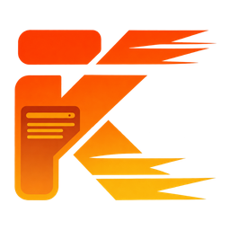

  

# krun

English · [简体中文](README.md)

krun is a self-hosted application platform. Its goal is to bring compute and storage capabilities similar to Cloudflare Workers, D1, and R2 to your own infrastructure, with compatibility for selected APIs. The project also aims to support more application runtimes so teams can deploy and manage different types of applications.

krun is pre-launch. It currently supports running and managing Workers, object storage, managed PostgreSQL access, and selected Cloudflare Workers APIs and Wrangler workflows. Additional application runtimes remain a project goal. See the [Cloudflare protocol adapter](docs/cloudflare-api.md) for the management API and CLI coverage.

## Current capabilities

- Create Workers, build and release versions, and manage environments, domains, and resource pools in the console.
- Deploy Workers through supported Cloudflare APIs and Wrangler workflows.
- Bind logical buckets backed by S3-compatible storage to Workers and manage objects in the console.
- Manage access through organizations, members, roles, and API keys, and manage identities and organizations from the CLI.

## Workers binding compatibility

krun runs module-format JavaScript and TypeScript Workers on workerd. The table lists the supported Cloudflare Workers bindings and their main limits.

| Binding | Compatibility |
| --- | --- |
| Environment variables (`plain_text`, `json`) | Read strings and JSON values through `env`. Values are frozen per version, and Wrangler supports `--keep-vars`. |
| Secrets (`secret_text`) | Read secret strings through `env` and manage them in the console or with Wrangler. Management endpoints return redacted metadata only. |
| Version metadata (`version_metadata`) | Read `id`, `tag`, and `timestamp` through the configured `env` binding. |
| Static assets (`assets`) | Supports `env.ASSETS.fetch(request)` with a configurable binding name, assets-only deployments, and common routing modes including SPA fallback. Rewrites are limited to same-site paths. [Asset configuration](user-docs/src/content/docs/guides/wrangler-configuration.md#静态资产配置) |
| R2 (`r2_bucket`) | S3-compatible logical buckets support `head`, `get`, `put`, `delete`, `list`, multipart uploads, and common range and conditional requests. Lists return up to 64 items per page, and batch deletes accept up to 1,000 keys. `startAfter`, SSE-C, PUT checksums, and combined conditions are outside the supported subset. [R2 methods and limits](docs/workers-r2.md#已实现的-runtime-api) |
| Hyperdrive (`hyperdrive`) | Supports PostgreSQL configuration management and `env.DB.connectionString` with a configurable binding name. The Worker connects directly to PostgreSQL through workerd under its pool egress policy. Query caching and platform connection pooling are outside the supported subset. [Managed PostgreSQL access](user-docs/src/content/docs/guides/workers-hyperdrive.md) |

KV, D1, Durable Objects, Queues, and Service bindings are currently unavailable. The global Cache API supports `caches.default`, `caches.open()`, and `put`, `match`, and `delete`, with cache entries scoped to a single runtime process. [Cache API](docs/workers-r2.md#cache-api)

For console builds from a repository, configure variables, secrets, version metadata, R2, and Hyperdrive in the target krun environment. Static assets ship with the build artifact. Direct Wrangler deployments can submit bindings from project configuration during upload. Use `wrangler secret put` to manage secrets. [Wrangler configuration compatibility](user-docs/src/content/docs/guides/wrangler-configuration.md)

See the [Workers binding compatibility test matrix](docs/verification.md#workers-bindings-兼容测试) for test cases and environments, and the [R2 open-source project tests](docs/workers-r2.md#开源项目验证) for scenarios from five real projects.

## Architecture and deployment

krun consists of a static React and Vite console, a Go control plane, and a Workers runtime based on workerd. The built console is hosted as static files. Production deployments must forward `/api/*` to the Go control plane on the same origin. See the [deployment guide](docs/deployment.md).

Local development uses a local-first topology. The control plane, PostgreSQL, builder, and frontend run on the developer machine. The cluster runs the serving runtime, a separate validator, and kgateway. See [local development](docs/local-dev.md) for configuration and startup steps.

## Documentation

- [User guide and quick start](user-docs/src/content/docs/index.md)
- [Development and architecture documentation](docs/README.md)
- [Worker example](examples/workers-fullstack/README.md)
