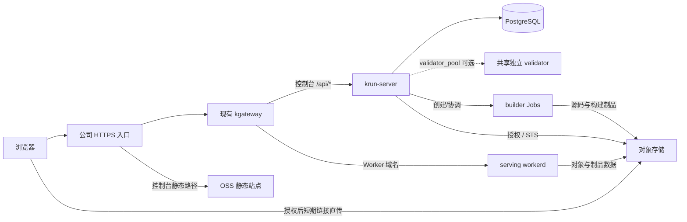

# 公司内网部署

交付物面向已有 Kubernetes + Gateway API/kgateway 的单地域试用版。默认示例使用一个
private pool、一个业务 domain 和一个已存在 Gateway。前端在 OSS；Go、serving workerd 和可选独立 validator 在专用 namespace，builder 按需创建 Job。数据库、对象桶、
SSO、TLS/内网入口、镜像仓库和 Gateway 由公司基础设施提供。本目录不创建数据库、
云账号、桶策略、公网 LB 或证书，也不运行 kind/dev SSH 脚本。



## 交付物

- `Dockerfile.control`：纯 Go 控制面，无测试 CA、开发登录或前端文件；构建上下文排除 `.data/`。
- `workers/runtime/Dockerfile`、`workers/builder/Dockerfile`：固定依赖的实际运行/构建镜像。
- `config/production.example.yaml`：完整主配置；deployment 输入也在这同一份文件。
- `config/test.example.yaml`：内网、Office、公网三个独立网关/运行池的完整测试模板。
- `cmd/krun-deploy`：离线渲染 Secret、ConfigMap、Deployment、Service、RBAC、NetworkPolicy、PDB、HTTPRoute。
- `scripts/build-deployment.sh`：构建三个镜像，只有显式 `--push` 才上传。
- `scripts/package-console.sh`：静态检查并打包完整 `dist/console/`（含用户文档和 CLI 下载），不启动 Node 服务或自动上传。
- `scripts/deploy-production.sh`：默认只渲染；写集群必须同时传 `--context` 和 `--apply`。
- `gateway.example.yaml`：可选的公司网关管理员参考配置，不被部署脚本自动应用。

## 基础设施契约

1. 使用专用 namespace；渲染器管理该 namespace 的 default ServiceAccount，给 builder
   配置镜像拉取 Secret，并设置默认不挂载 API Token。不能复用有其他业务的 namespace。
2. Gateway 位于独立 namespace，使用 HTTP listener，默认端口 8080，hostname 留空。
   `allowedRoutes` 允许 `app.kubernetes.io/part-of: krun` 的 namespace，且 Gateway 必须
   `Programmed=True`。公司 HTTPS 入口保留完整 Host，转发到 Gateway Service。
   若 listener 为其他 HTTP 端口，可在主配置 `workers.gateways[].base` 指定其集群
   Service origin，例如 `http://krun-internal.kgateway-system.svc:80`，不能使用 SSH 地址。
   数据面 Service 名须与 Gateway 名一致，Pod 带
   `gateway.networking.k8s.io/gateway-name: <Gateway 名>` 标签，生成的网络策略依此放行。
   selfManaged Gateway 的 Service/数据面由公司另行部署，单独创建 Gateway 对象并不会提供入口。
3. `gateway.example.yaml` 使用 kgateway GatewayParameters 将数据面 Service 设为
   ClusterIP；TLS 和内网入口仍由公司管理。参考
   [kgateway API](https://kgateway.dev/docs/envoy/latest/reference/api/)；按公司安装版本审查 CRD。
4. 控制台域名如 `krun.example.com`；业务域名另设 `workers.example.com`。查看渲染后的
   summary，为 `*.workers.example.com` 和 `static.workers.example.com` 配置 DNS/TLS。
   Worker 地址使用 `w-<slug>-<environment>.workers.example.com`，不包含 pool hash。
   每个业务 domain 通过 Network Profile 绑定唯一 pool，扩容使用该 pool 的副本数。
5. 渲染器只生成控制台 `/api` 到 Go 的 HTTPRoute，不创建前端代理 Deployment。公司
   CDN / 入口代理在同一个 origin 下将 `/`、`/assets/*` 回源 OSS，其他静态路径返回 404。
6. 静态发布平台负责 OSS 的访问权限与私有回源。不要把制品桶当作控制台公开静态桶。
7. 集群 CNI 必须执行 NetworkPolicy，控制面到 Kubernetes API、数据库、SSO/Git、STS、
   存储的 CIDR/端口，以及 builder 到 npm/存储的网络范围必须在主 YAML 显式声明。
   DNS IP 必须是本集群真实的 CoreDNS/NodeLocal DNS IP，示例中的 TEST-NET 地址不能照抄。

## 准备主配置与密钥

部署工具机/CI 需要 Go 1.26、Node.js 24/npm、Python 3、Docker 和 kubectl；集群运行期
不需要这些构建工具。首次安装者需要创建专用 namespace、在其中管理清单资源，以及
在 Gateway namespace 创建对应的只读 Role/RoleBinding；应用本身只获得生成的有限权限。

在 CI/密钥平台维护一份主 YAML，以 `config/production.example.yaml` 为起点，填充公司
实际变量。需要本地验证时使用唯一 `.data/dev.yaml`，不要新建第二份本地应用 YAML，
也不要覆盖正在运行的开发配置。CI 可以用其挂载的单一主配置路径。

必须提供：

- PostgreSQL 独立数据库及备份；完整 schema 由当前源码初始化，不做自动迁移/删库。
- 公司 OIDC/OAuth2 应用；回调为 `https://<console>/api/auth/company/callback`。
- 公司 GitLab OAuth 应用；回调为
  `https://<console>/api/v1/workers/repository/company-gitlab/callback`，用户连接自己的仓库授权。
  也可以使用管理员只读 Token 和明确的 `allowed_repositories`，配置见
  [仓库说明](../../docs/workers-repositories.md)。只构建公开仓库时可去掉仓库 OAuth 凭据。
- 私有制品桶及仅用于该 namespace 的 prefix，稳定的 storage location ID。
- 独立业务对象桶；TOS AssumeRole 的角色授权和信任关系，或已实现的 static S3 provider。
- 随机 Runtime/Management Token、32-byte Worker 加密 key ring、32-byte base64url cursor key。
- 公司镜像名、镜像拉取 Secret、真实网络范围；静态源站由发布平台单独管理。

`config/test.example.yaml` 提供 internal/office/public 三个入口与各自 pool 的主配置
模板，控制台 API 默认挂在 office Gateway；模板中的真实值由密钥平台提供。静态发布
目录和 OSS key 前缀在发布平台配置，浏览器仍使用 `/` 和 `/assets/*`。

可用 `openssl rand -base64 32` 生成 Worker 加密 key；cursor key 使用相同随机字节的
base64url 编码并去掉 `=`。密钥只在密钥平台或 gitignored 主配置中保存；不要每次
发布重新生成 token/key，仍有保留 Version 引用的旧加密 key 不能删除。

渲染器拒绝开发模式、local builder、`Never` 拉取策略、managed/匿名制品存储、SSH
管理地址、示例凭据、全零加密 key，以及共享系统 namespace。多个 pool 会各自生成
serving、可选共享 validator 与网络策略；多个 Gateway 时必须在 `deployment.console_gateway` 指定
控制台使用的 Gateway ID，所有 Gateway 都要通过预检。每个业务 domain 必须经 Profile 唯一选择一个运行池。

## 构建与打包

下面的值是占位示例，替换为公司镜像仓库和实际 release tag：

```sh
scripts/build-deployment.sh --registry registry.example.com/team --tag RELEASE --platform linux/amd64
# 确认镜像与扫描结果后，显式 --push；也支持 linux/arm64。
scripts/build-deployment.sh --registry registry.example.com/team --tag RELEASE --platform linux/amd64 --push
scripts/package-console.sh .data/console-release
```

把主配置的 control/runtime/builder image 指向本次 tag 或 digest。应用镜像的底层
镜像/包源应走公司镜像与包代理；
控制面 Dockerfile 的 `GO_IMAGE`、`BASE_IMAGE` 可通过 Docker build args 替换。

将 `dist/console/` 的内容上传到静态桶根目录；不要上传仓库、主配置、Secret manifest、
`.data/` 或 `dist/` 的其他内容。源站需要支持正确的 JS/CSS MIME 类型。入口 no-store，
带 hash 的 assets 长期缓存由 CDN / 静态源站配置落实。

## 渲染、检查、部署

`MAIN_YAML`、`PRIVATE_OUTPUT` 和 `COMPANY_CONTEXT` 都由操作者显式指定，不依赖当前
kubectl context。输出目录在 checkout 内时必须位于 `.data/`；也可使用 checkout 外的
私有 CI 临时目录。

```sh
scripts/deploy-production.sh --config "$MAIN_YAML" --out "$PRIVATE_OUTPUT"
```

生成：

- `resources.json`：**包含实际 Secret 的私有清单**，权限 0600；不要 cat、提交、发评审
  或放到公共构建制品。Secret 使用 data，避免 stringData 与 server-side apply 的问题。
- `summary.json`：无凭据的资源清单、DNS 后缀和 Gateway 要求，供审查。
- `browser-cors.json`：业务桶所需 CORS 规则参考。合并到原规则，不覆盖已有业务规则；
  TOS 原生 API 外层使用 CORSRules，按厂商控制台/API 配置。

```sh
# server dry-run 要求目标 namespace 已存在；它不会替你创建 namespace。
scripts/deploy-production.sh --config "$MAIN_YAML" --out "$PRIVATE_OUTPUT" \
  --context "$COMPANY_CONTEXT" --dry-run

# 明确部署；预检现有 Gateway，apply 并等待所有 Deployment rollout。
scripts/deploy-production.sh --config "$MAIN_YAML" --out "$PRIVATE_OUTPUT" \
  --context "$COMPANY_CONTEXT" --apply
```

Gateway 的 namespace、listener、HTTP 端口、namespace selector 或状态不匹配时，脚本
会在 apply 前停止。Kubernetes API 版本为 apps/v1、policy/v1、networking.k8s.io/v1
和 gateway.networking.k8s.io/v1。不会安装/升级公司 Gateway API 或 kgateway CRD。

## 首次初始化与验收

1. 验证公司 HTTPS 入口的 `/`、`/assets/*`、`/api/healthz`；未知静态路径应为 404。
2. 通过 SSO 登录创建本地用户，取得其 user_id，由管理员执行一次：

```sh
kubectl --context "$COMPANY_CONTEXT" -n "$NAMESPACE" exec deployment/krun-control -- \
  /app/krun-server bootstrap --config /config/control.yaml --user "$USER_ID"
```

3. 管理员创建组织、授权成员，选择内网 Network Profile。
4. 绑定真实测试仓库，完成构建、validator 校验、发布、ACK、业务调用和回滚。
5. 检查 builder Job 没有 API Token，serving 和 validator 凭据不同，管理端口/内部
   Runtime API 无公网路由。Go 只有 namespace Role，不授予 cluster-admin。
6. 按 browser-cors.json 合并业务桶 CORS，测试浏览器真实 PUT、下载、删除和 R2 读取。
   CSP connect-src 由静态发布平台列入确切对象存储 origin。
7. 在公司专用验收环境完成 UI/E2E。仓库 UI 的 console workflow 使用 kind-git fixture，
   不能直接拿公司真实仓库代替该 fixture；生产验收应按上面的实际业务步骤执行。

## 网络与权限边界

Go 独占 DB、公司登录/仓库凭据、业务存储的 STS issuer 和 CDN key。Serving 可信入口
只收到 Runtime/Management Token 和制品存储签名凭据；业务 Worker 不收到这些能力。
Validator 只有自己的 Runtime Token 和 Management Token，不接业务 Service/Gateway。
R2 数据由 serving 内可信 signer 直连存储，临时凭据在该进程缓存；文件字节不走 Go。

默认拒绝 namespace 入站/出站；按角色和目的地放行。`public_https: true` 显式允许
常见私有/loopback/link-local 段以外的 IPv4 TCP/443，用于 IP 会变化的云存储；它不是
FQDN 白名单。需要更严的目的域限制时，使用公司 CNI 的 FQDN 策略或受控出口代理，
不要把可移植 NetworkPolicy 的端口限制当作域名限制。公司内试用先限可信项目；构建
会执行仓库脚本，面向不可信代码时配置 builder/runtime 的沙箱 RuntimeClass。

## 更新与恢复

保留每个 release 的私有配置清单、镜像 digest、数据库备份及 Worker 加密 key ring。
更新时重新渲染并 apply；pod template 的配置/Secret hash 会触发 rollout。回退应重新
应用上一版完整清单，不能只 rollout undo 后假定 Secret/ConfigMap 也被回退。

数据库 schema fingerprint 不一致会拒绝启动。当前没有自动数据库升级机制，公司
持久数据必须先制定迁移与恢复步骤，不能复用开发环境清库流程。更换 storage location、
pool ID、域名或存储 prefix 也需要显式规划；不要原地把稳定 ID 指向另一个安全边界。

## 三入口集群测试配置

`config/test.example.yaml` 引用现有 `kgateway-system/krun-internal`、`krun-office`、
`krun-public`，listener 均为 `http:80`。模板分别使用 `internal-a`、`office-a`、
`public-a` 三个池，默认复用业务 Pod 校验；设置 `workers.validator_pool: office-a`
可共用一个独立 validator。`pool_selector` 和 `domain_selector` 按 exposure
匹配。Office 使用 private 访问类型。控制台 API 通过 `deployment.console_gateway: office`
仅挂在 Office Gateway；业务 HTTPRoute 在控制面运行后协调产生。

Gateway 的 base 是同名 Service 的预期集群地址。渲染器不会创建或修改 Gateway
及其 Service；selfManaged Gateway 若暂未创建 Service，必须在实际验收前补齐。
不使用 hostNetwork。仅有 Gateway `Programmed=True` 不表示外部入口已可访问。

静态发布平台可使用 `test/krun/console` 作为 OSS 对象 key 前缀。将静态构建产物
放在该前缀内，并由入口映射为浏览器的 `/` 和 `/assets/*`。
制品和业务数据分别用其他私有前缀，不能因静态回源而公开整个共享桶。
测试模板所有真实值用占位符；用户指定的私有 `test.yaml` 只通过 `--config` 显式加载。
实际发布前必须验证 CNI 的 NetworkPolicy 执行能力、Gateway Service、DNS/TLS、SSO
回调白名单、静态回源权限和镜像 tag；数据库与存储的 CIDR 快照变化时应重新生成。

控制面运行时支持主 YAML 中的 `workers.kubernetes_kubeconfig_file` 和可选
`workers.kubernetes_context`，用于本地/集群外控制面；配置方式见
[本地开发](../../docs/local-dev.md#显式-kubeconfig)。本目录的标准集群内渲染器仍要求
ServiceAccount 凭证，不读取或打包操作者的 kubeconfig。

候选校验默认复用业务 pool 的 Ready Pod，不额外渲染 validator。需要进程隔离时在主配置
设置 `workers.validator_pool` 为已有 pool ID，所有业务 pool 共用该池的独立 validator。
升级期间暂停发布，先升级 runtime 镜像再升级控制面后恢复发布；旧镜像不支持 `validation_protocol: 1` 时会等待。
切换模式不自动删除旧 validator 资源；确认新模式可发布后显式清理。
