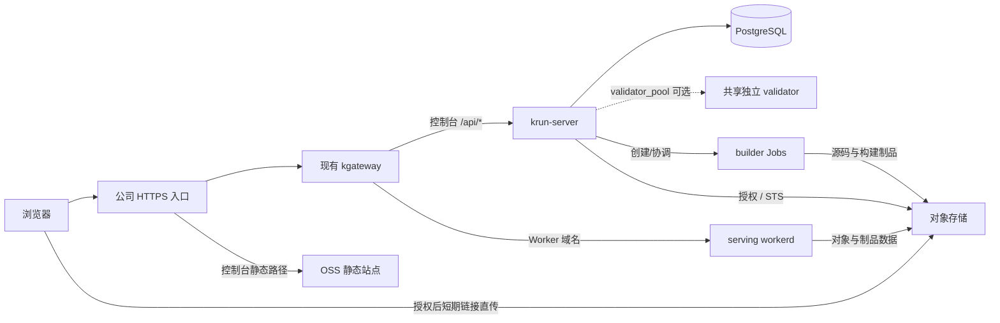

# 公司内网部署

交付物面向已有 Kubernetes + Gateway API/kgateway 的单地域试用版。默认示例使用一个
private pool、一个业务 domain 和一个已存在 Gateway。前端在 OSS；Go、serving workerd 和可选独立 validator 在专用 namespace，builder 按需创建 Job。数据库、对象桶、
SSO、TLS/内网入口、镜像仓库和 Gateway 由公司基础设施提供。本目录不创建数据库、
云账号、桶策略、公网 LB 或证书，也不运行 kind/dev SSH 脚本。



## 交付物

- `Dockerfile.control`：纯 Go 控制面，无测试 CA、开发登录或前端文件；构建上下文排除 `.data/`。
- `workers/runtime/Dockerfile`、`workers/builder/Dockerfile`：固定依赖的实际运行/构建镜像。
- `config/example.yaml`：完整主配置；deployment 输入也在这同一份文件。
- `scripts/build-deployment.sh`：构建三个镜像，只有显式 `--push` 才上传。
- `scripts/package-console.sh`：静态检查并打包完整 `dist/console/`（含用户文档和 CLI 下载），不启动 Node 服务或自动上传。
- `gateway.example.yaml`：可选的公司网关管理员参考配置，由部署方按需维护。

## 基础设施契约

1. 使用专用 namespace；部署方管理该 namespace 的 default ServiceAccount，给 builder
   配置镜像拉取 Secret，并设置默认不挂载 API Token。不能复用有其他业务的 namespace。控制面 ServiceAccount 需要在 Workers namespace 对
   Job 有 `get/list/create/patch/delete` 权限，对 Secret 有 `get/list/create/patch/delete`
   权限，对 Pod 有 `get/list/delete` 权限；后台按标签清理已删除 Worker 的构建资源。
2. Gateway 位于独立 namespace，使用 HTTP listener，默认端口 8080，hostname 留空。
   `allowedRoutes` 允许 `app.kubernetes.io/part-of: krun` 的 namespace，且 Gateway 必须
   `Programmed=True`。公司 HTTPS 入口保留完整 Host，转发到 Gateway Service。
   若 listener 为其他 HTTP 端口，可在主配置 `workers.gateways[].base` 指定其集群
   Service origin，例如 `http://krun-internal.kgateway-system.svc:80`，不能使用 SSH 地址。
   数据面 Service 名须与 Gateway 名一致，Pod 带
   `gateway.networking.k8s.io/gateway-name: <Gateway 名>` 标签，网络策略需据此放行。
   selfManaged Gateway 的 Service/数据面由公司另行部署，单独创建 Gateway 对象并不会提供入口。
3. `gateway.example.yaml` 使用 kgateway GatewayParameters 将数据面 Service 设为
   ClusterIP；TLS 和内网入口仍由公司管理。参考
   [kgateway API](https://kgateway.dev/docs/envoy/latest/reference/api/)；按公司安装版本审查 CRD。
4. 控制台域名如 `krun.example.com`；业务域名另设 `workers.example.com`。为 `*.workers.example.com` 和 `static.workers.example.com` 配置 DNS/TLS。
   Worker 地址使用 `w-<slug>-<environment>.workers.example.com`，不包含 pool hash。
   每个业务 domain 通过 Network Profile 绑定唯一 pool，扩容使用该 pool 的副本数。
5. 部署方配置控制台 `/api` 到 Go 的 HTTPRoute。公司
   CDN / 入口代理在同一个 origin 下将 `/`、`/assets/*` 回源 OSS，其他静态路径返回 404。
6. 静态发布平台负责 OSS 的访问权限与私有回源。不要把制品桶当作控制台公开静态桶。
7. 如果部署方使用 NetworkPolicy，集群 CNI 必须执行策略；控制面到 Kubernetes API、数据库、SSO/Git、STS、
   存储的 CIDR/端口，以及 builder 到 npm/存储的网络范围必须在主 YAML 显式声明。
   DNS IP 必须是本集群真实的 CoreDNS/NodeLocal DNS IP，示例中的 TEST-NET 地址不能照抄。

## 准备主配置与密钥

部署工具机/CI 需要 Go 1.26、Node.js 24/npm、Python 3、Docker 和 kubectl；集群运行期
不需要这些构建工具。首次安装者需要创建专用 namespace、在其中管理清单资源，以及
在 Gateway namespace 创建对应的只读 Role/RoleBinding；应用本身只获得所需的有限权限。

在 CI/密钥平台维护一份主 YAML，以 `config/example.yaml` 为起点，填充公司
实际变量。需要本地验证时使用唯一 `.data/dev.yaml`，不要新建第二份本地应用 YAML，
也不要覆盖正在运行的开发配置。CI 可以用其挂载的单一主配置路径。

必须提供：

- 独立 PostgreSQL 数据库及备份。空库启动时初始化完整 schema，已有库通过显式命令升级。
- 公司 OIDC/OAuth2 应用；回调为 `https://<console>/api/auth/company/callback`。
- 公司 GitLab OAuth 应用；回调为
  `https://<console>/api/v1/workers/repository/company-gitlab/callback`，用户连接自己的仓库授权。
  也可以使用管理员只读 Token 和明确的 `allowed_repositories`，配置见
  [仓库说明](../../docs/workers-repositories.md)。只构建公开仓库时可去掉仓库 OAuth 凭据。
- 私有制品桶及仅用于该 namespace 的 prefix，稳定的 storage location ID。
- 独立业务对象桶；TOS AssumeRole 的角色授权和信任关系，或已实现的 static S3 provider。
- 随机 Runtime/Management Token、32-byte Worker 加密 key ring、32-byte base64url cursor key。
- 公司镜像名、镜像拉取 Secret、真实网络范围；静态源站由发布平台单独管理。

多入口部署可按 `config/example.yaml` 中的说明增加 Gateway、域名、运行池和网络档案；
通过 `deployment.console_gateway` 选择控制台入口。静态发布
目录和 OSS key 前缀在发布平台配置，浏览器仍使用 `/` 和 `/assets/*`。

可用 `openssl rand -base64 32` 生成 Worker 加密 key；cursor key 使用相同随机字节的
base64url 编码并去掉 `=`。密钥只在密钥平台或 gitignored 主配置中保存；不要每次
发布重新生成 token/key，仍有保留 Version 引用的旧加密 key 不能删除。

生产部署应使用独立 namespace、受限的 ServiceAccount 和可拉取的镜像。每个业务
域名必须经 Network Profile 唯一选择一个运行池；部署方负责配置各池的 Runtime、网络策略和 Gateway。

## 构建与打包

下面的值是占位示例，替换为公司镜像仓库和实际 release tag：

```sh
scripts/build-deployment.sh --registry registry.example.com/team --tag RELEASE --platform linux/amd64
# 确认镜像与扫描结果后，显式 --push；也支持 linux/arm64。
scripts/build-deployment.sh --registry registry.example.com/team --tag RELEASE --platform linux/amd64 --push
scripts/package-console.sh .data/console-release
```

把主配置的 control/runtime/builder image 指向本次 tag 或 digest。应用镜像的底层
镜像/包源应走公司镜像与包代理；
控制面 Dockerfile 的 `GO_IMAGE`、`BASE_IMAGE` 可通过 Docker build args 替换。

将 `dist/console/` 的内容上传到静态桶根目录；不要上传仓库、主配置、Secret manifest、
`.data/` 或 `dist/` 的其他内容。源站需要支持正确的 JS/CSS MIME 类型。入口 no-store，
带 hash 的 assets 长期缓存由 CDN / 静态源站配置落实。

## 部署

Kubernetes 工作负载、Secret、Service、网络策略和 Gateway 由部署方按照目标环境维护和部署。
serving Runtime 可从主配置中的 pool [生成并预览清单](../../docs/workers-pools.md#生成-serving-清单)。
部署前检查资源权限、镜像、域名、证书及网络连通性。

## 首次初始化与验收

1. 验证公司 HTTPS 入口的 `/`、`/assets/*`、`/api/healthz`；未知静态路径应为 404。
2. 通过 SSO 登录创建本地用户，取得其 user_id，由管理员执行一次：

```sh
kubectl --context "$COMPANY_CONTEXT" -n "$NAMESPACE" exec deployment/krun-control -- \
  /app/krun-server bootstrap --config /config/control.yaml --user "$USER_ID"
```

3. 管理员创建组织、授权成员，选择内网 Network Profile。
4. 绑定真实测试仓库，完成构建、validator 校验、发布、ACK、业务调用和回滚。
5. 检查 builder Job 没有 API Token，serving 和 validator 凭据不同，管理端口/内部
   Runtime API 无公网路由。Go 只有 namespace Role，不授予 cluster-admin。
6. 配置业务桶 CORS，测试浏览器真实 PUT、下载、删除和 R2 读取。
   CSP connect-src 由静态发布平台列入确切对象存储 origin。
7. 在公司专用验收环境完成 UI/E2E。仓库 UI 的 console workflow 使用 kind-git fixture，
   不能直接拿公司真实仓库代替该 fixture；生产验收应按上面的实际业务步骤执行。

## 网络与权限边界

Go 独占 DB、公司登录/仓库凭据、业务存储的 STS issuer 和 CDN key。Serving 可信入口
只收到 Runtime/Management Token 和制品存储签名凭据；业务 Worker 不收到这些能力。
Validator 只有自己的 Runtime Token 和 Management Token，不接业务 Service/Gateway。
R2 数据由 serving 内可信 signer 直连存储，临时凭据在该进程缓存；文件字节不走 Go。

生产清单不创建 NetworkPolicy；部署方可自行配置并维护网络策略。
公司内试用先限可信项目；构建
会执行仓库脚本，面向不可信代码时配置 builder/runtime 的沙箱 RuntimeClass。

## 更新与恢复

### 控制面断连

Serving Pod 保留最后已确认的路由和已加载的 Worker。控制面或控制面 PostgreSQL 断连时，
已加载且依赖可用的版本继续处理请求。`/ready` 可返回 200，最后一次有效配置同步满 60 秒后
`config_fresh` 为 `false`。发布、配置变更、冷加载和存储凭据续签仍依赖控制面。
生产可在主配置设置 `deployment.control_replicas` 和 `deployment.runtime_replicas` 至少为 2，
并为 PostgreSQL 使用可故障切换的连接入口。断连期间保留已就绪的 serving 副本。
需要在控制面不可用时紧急停止流量，可在 Gateway 关闭对应业务入口。数据库备份恢复前隔离旧 serving 流量，轮换配置代次并验证新 serving 后再切流。

断连演练使用隔离环境：先通过真实业务入口预热，再中断 Runtime 到控制面的连接，等待超过 60 秒。
预期热版本和其已缓存资产继续返回原状态，管理端 `/ready` 返回 200 且 `config_fresh: false`，
`krun_runtime_config_fresh` 为 0；未缓存依赖无法加载的业务请求返回 503 `runtime unavailable`。
恢复连接后，检查配置新鲜度恢复，并验证一次停用变更使对应业务请求返回 410 `environment disabled`。

### 备份恢复后的配置代次

前置条件：已隔离业务入口并停止所有连接该数据库的控制面和 serving 实例，PostgreSQL 已恢复，
主配置指向恢复后的数据库且 schema 校验通过。在仓库根目录使用 Go 1.26 执行；
将 `KRUN_CONFIG` 替换为密钥平台挂载的唯一主配置路径：

```bash
KRUN_CONFIG=/path/to/main.yaml
go run ./cmd/krun-server rotate-runtime-config-epoch --config "$KRUN_CONFIG"
```

命令输出新的 32 位十六进制代次。启动控制面和新 serving 后，确认其管理端 `/ready` 返回 200，
`config_epoch` 与输出相同；通过真实业务入口验证版本、资产和绑定，再恢复业务入口。
未轮换代次或仍能承流的旧 serving 可能继续使用备份恢复前的配置。

### 手动在线升级

按[手动执行在线迁移](../../docs/storage.md#手动执行在线迁移)审核并执行增量 SQL，再滚动发布。
执行前验证迁移兼容所有仍可能运行或重启的版本，并检查并发回填和锁等待。数据库当前基线为
`0001_initial.sql`，新库由控制面初始化；旧测试数据不属于此迁移链，使用新的空库初始化。
迁移失败时检查 SQL 与迁移记录，完成修复后再发布。

## 三入口集群测试配置

在 `config/example.yaml` 的 `workers.gateways`、`domains`、`runtime_pools` 和
`network_profiles` 中分别添加 internal、office、public 条目，并用 labels 和对应 selector
将每个域名匹配到自己的运行池。Office 使用 private 访问类型。设置
`deployment.console_gateway: office` 可将控制台 API 挂到 Office Gateway；
默认复用业务 Pod 校验，需要独立 validator 时设置 `workers.validator_pool` 为对应池 ID。
业务 HTTPRoute 在控制面运行后协调产生。
Gateway 的 base 是同名 Service 的预期集群地址。部署方负责 Gateway
及其 Service；selfManaged Gateway 若暂未创建 Service，必须在实际验收前补齐。
不使用 hostNetwork。仅有 Gateway `Programmed=True` 不表示外部入口已可访问。

静态发布平台可使用 `test/krun/console` 作为 OSS 对象 key 前缀。将静态构建产物
放在该前缀内，并由入口映射为浏览器的 `/` 和 `/assets/*`。
制品和业务数据分别用其他私有前缀，不能因静态回源而公开整个共享桶。
示例中的值是占位符；用户指定的私有 `test.yaml` 只通过 `--config` 显式加载。
实际发布前应验证已启用的网络策略、Gateway Service、DNS/TLS、SSO
回调白名单、静态回源权限和镜像 tag；数据库与存储的 CIDR 变化时应更新网络策略。

控制面运行时支持主 YAML 中的 `workers.kubernetes_kubeconfig_file` 和可选
`workers.kubernetes_context`，用于本地/集群外控制面；配置方式见
[本地开发](../../docs/local-dev.md#显式-kubeconfig)。集群内部署可使用受限的 ServiceAccount 凭证。

候选校验默认复用业务 pool 的 Ready Pod，不需要独立 validator。需要进程隔离时在主配置
设置 `workers.validator_pool` 为已有 pool ID，所有业务 pool 共用该池的独立 validator。
升级期间暂停发布，先升级 runtime 镜像再升级控制面后恢复发布；旧镜像不支持 `validation_protocol: 1` 时会等待。
切换模式不自动删除旧 validator 资源；确认新模式可发布后显式清理。
