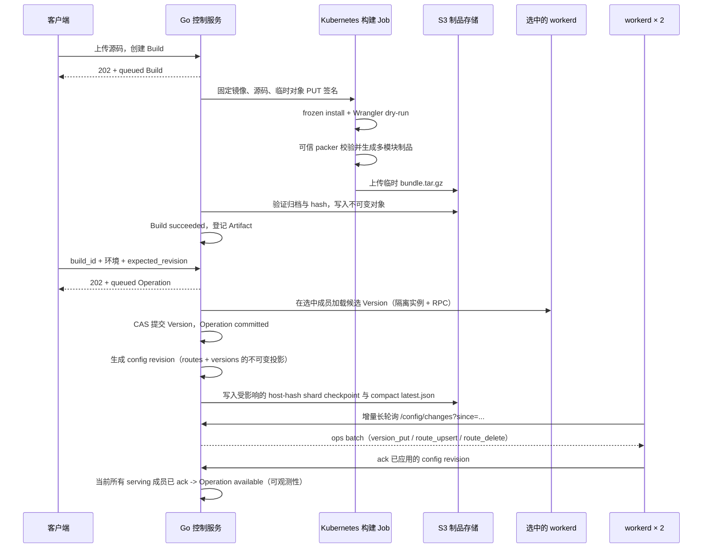

# Workers 构建与发布后端

业务实现在 `internal/workers`，HTTP 入口在 `internal/control/workers_*.go`，构建器和运行时分别在 `workers/builder`、`workers/runtime`。复用现有 Go 控制服务的登录、API Key、Cedar 权限和 PostgreSQL 状态存储。界面集成在 React 控制台，体验入口与验证见 [Workers 控制台](workers-console.md)。kind 部署与验收入口见 [部署说明](../deploy/workers-kind/README.md)。

Workers 与认证配置在同一个 YAML 文件，完整示例见 [config/example.yaml](../config/example.yaml) 的 `workers:` 段。配置该段即启用 Workers；省略时控制面仍正常启动，所有 Workers 接口返回 `503 WORKERS_NOT_CONFIGURED`，`/api/auth/me` 的 `workers_configured` 为 `false`，控制台显示“Workers 未配置”。

控制面、builder 和 runtime 可以使用不同的 S3 endpoint，但必须指向同一个桶和
前缀。配置与访问模式见 [对象存储](object-storage.md)，开发拓扑见
[本地开发](local-dev.md)。

## 实际流程



构建和发布都异步处理。Build、源码、Operation、Version、历史、幂等记录和执行者身份都按实体持久化在 PostgreSQL 的 `krun_worker_*` 表中。边缘配置的当前发布头按 route / version 分行保存在 `worker_config_routes` 与 `worker_config_versions`，`worker_config_revisions` 只保存 revision 元数据，增量则是一条 op 一行的 `worker_config_ops`。runtime ack 存在独立的 `worker_runtime_acks`（每个 Pod 一行）。未完成的 Build / Operation 行就是持久化工作队列；控制服务重启后扫描恢复。多个控制服务通过行级 CAS 与超时租约竞争不同工作，配置发布通过 `worker_config_head` CAS 线性推进，不做 advisory-lock 选主。

Kubernetes、S3 和 runtime HTTP 请求均在 IAM 状态事务外进行。执行者的用户状态、AuthVersion、API Key 和当前权限会在执行及提交前重新检查。

## 配置版本接口

以下路径均以 `/api/v1/orgs/{org}/workers/{worker}/environments/{env}` 为前缀：

| 方法和路径 | 行为与权限 |
| --- | --- |
| `GET /configurations` | 按创建时间倒序返回本环境的命名配置，需 `worker.version.read` |
| `POST /configurations` | 创建不可变配置，需 `worker.update`；变更 Secrets 另需 `worker.publish` |
| `POST /configurations/{configuration}/deployments` | 组合所选配置和代码，创建标准 Version、Operation、Deployment，需 `worker.publish` 与 `worker.version.read` |

创建输入包含 `name`（必填，最多 100 字节）、`message`（最多 1000 字节）、
`expected_configuration_revision` 与 `idempotency_key`。可用 `source_configuration_id`
或 `source_version_id` 复制本 Worker、本环境的配置；不传时从当前环境草稿复制。可覆盖
`variables`、`r2_buckets`、`version_metadata`，`secrets` 以名称到新值或 `null` 的映射
新增、替换或删除；未传的绑定保留来源值。Secret 只返回名称，不返回值与内部版本 ID。

发布输入包含 `code_version_id`（必须为本环境当前版本）或首次部署使用的 `build_id`、
`expected_revision`、`expected_configuration_revision` 和 `idempotency_key`。使用配置时
同时更新该环境草稿，后续从构建发布沿用该配置；当前生效状态仍由原有运行时 ack 决定。
版本标签与说明映射为 Cloudflare `annotations["workers/tag"]` 和
`annotations["workers/message"]`。Cloudflare 现有路由、请求与响应结构、Previews Base
及 Secrets 发布语义不变；配置库是原生 API 管理能力，Cloudflare 客户端无需使用新接口。

配置行在 `krun_worker_configurations`，每个 Secret、R2 引用分别在
`krun_worker_configuration_secrets`、`krun_worker_configuration_r2` 中持久化。创建时在有界
事务内校验环境 revision 和引用，读取不写库。非活动配置保留 30 天，后台保护当前、已确认
和发布中的引用，每批最多删除 1000 份。DDL 仍以 `schema.sql` 和 fingerprint 为唯一基线，
已有开发数据库不自动迁移，需开发者显式重建专用库。

## 构建和制品

内联源码使用固定的 `esbuild` profile；仓库构建使用项目中的 Wrangler 配置和固定
版本的 `deploy --dry-run`，产出统一制品。构建输入、模块类型与隔离边界见
[构建兼容](workers-build-compatibility.md)，对外 Wrangler 部署与登录接口见
[Cloudflare 协议适配](cloudflare-api.md)。

项目必须提交且只提交一种受支持的锁文件；builder 使用镜像内固定版本的 npm、pnpm、Yarn 或 Bun 执行 frozen install，不通过 Corepack 在线下载任意工具版本。仓库模式会安装构建所需的 devDependencies，并可能执行 lifecycle/custom build，所以它本质上是租户代码执行；内联 direct 模式仍走更窄的依赖和 esbuild 路径。

`workers.npm_registry` 是唯一受信任的包源，默认 `https://registry.npmjs.org/`。控制面把该值显式传给 builder，不从隐藏环境变量决定行为。私有 registry 凭据、多个 registry 与 scoped auth 尚未实现；生产应使用稳定的内部包代理，并在 NetworkPolicy 中只放行该代理。

每次仓库构建为独立 Kubernetes Job：非 root、无 ServiceAccount Token、只读根文件系统、独立临时目录及 CPU / 内存 / 临时盘 / deadline 限额。一个 init container 只获得源码下载 URL 并执行不可信安装与构建；主容器只获得制品上传 URL，静态校验共享卷后生成归档，二者通过不同 Secret key 挂载，构建脚本看不到上传能力。Secret 归属于 Job，随 TTL 清理。生产多租户建议通过 `builder_runtime_class` 选择 gVisor、Kata Containers 或等价隔离。

归档仅包含：

```text
bundle.tar.gz
├── manifest.json
├── modules/index.js
├── modules/<additional ESM/CommonJS/Text/Data/Wasm>
└── assets/...
```

Manifest profile 固定为 `workerd-bundle-v2`：统一使用 schema 2，静态资产字段可选；同时固化 `compatibility_date`、排序后的 `compatibility_flags`、主模块和完整模块表。平台拒绝目录越界、PAX/GNU 扩展路径、符号链接、重复或未声明条目、超限大小、截断归档、类型不合法和 hash 不符的模块；Wasm magic、文本 UTF-8 与 source-map JSON 也会校验。构建 wrapper 保留原项目的命名导出，并增加 `KrunValidation` RPC 触发模块初始化和检查默认 `fetch`。

存储键：

```text
临时：uploads/{organization_id}/{build_id}/bundle.tar.gz
正式：v1/{organization_id}/sha256/{archive_sha256}/bundle.tar.gz
```

Artifact 记录包含 `storage_location_id`、`bucket`、`object_key`、归档 / manifest / 模块的 SHA-256、归档大小、组织和创建时间。当前仅配置一个 storage location；其 ID 必须稳定指向同一个存储位置。已有 location ID 不能直接改为另一个桶或 endpoint，需要显式迁移。

正式对象用条件 PUT 防止覆盖，已存在对象必须与本次内容完全一致。相同组织、相同归档复用 Artifact。Job 成功并不直接代表 Build 成功：只有平台完成验证和正式对象登记才标记 `succeeded`。成功 finalize 后删除临时对象。每次冷加载再次核验完整归档及元数据。

## 环境、发布和回滚

每个 Worker默认有 `production` 环境，可通过环境 API 创建和删除 preview。各自具有独立配置 revision、Version revision、Host 和历史。

Build 是编译结果，不是某个环境的活动版本。同一个成功 Build 可发布到多个环境。构建请求的 `environment` 用于权限和构建记录，不会把生产变量写进制品。

Version 固定引用 Artifact、目标环境、构建 profile、compatibility 配置、普通变量和 Secret version 集合。创建版本不会改变线上流量，部署时使用创建时冻结的快照。`POST /environments/{env}/versions` 从成功 Build 或本 Worker已有制品创建版本；`POST /environments/{env}/deployments` 接受 `version_id` 部署已有版本，也支持 `build_id` 完成创建并部署。

创建版本可传 `expected_configuration_revision`，与目标环境的配置 revision 不一致时
返回 `409 REVISION_CONFLICT`，不生成版本。控制台确认配置后携带此字段，避免冻结的
内容与确认框不一致。同一幂等 key 和输入的重试返回原版本，即使环境配置随后已改变。

普通变量支持 JSON 字符串、对象、数组、数字、布尔和 null，嵌套值随版本独立冻结。
环境配置的 `version_metadata` 指定元数据 binding 名，留空关闭；运行时提供
`{id,tag,timestamp}`。创建版本可以传 `tag`（最多 100 bytes）和 `message`（最多
1000 bytes），两者与创建时间一同保持不可变，控制台版本列表展示标签和说明。

Deployment 独立记录目标 Version、Operation、创建时间、30 天的固定地址保留期以及提交时间。Operation 负责校验、CAS 提交和 ACK 收敛；只有通过校验并提交的 Deployment 才生成固定地址。环境地址跟随当前部署，固定地址在有效期内指向该次部署的 Version。删除 Preview、撤销 Worker或修改访问边界后会撤销相应路由；部署地址不会绕过当前网络边界。域名及资源池拓扑变更需要协调地址和路由。

Previews Base 使用独立配置范围；新建 Preview 复制其普通变量与不可变 Secret 引用，后续 Base 修改只影响新建 Preview，生产配置独立。`GET/PATCH /previews-base` 管理基础变量，`PATCH /previews-base/secrets` 管理基础密钥。
Secret 的普通写操作会自动部署：`PUT`（新增或轮换）和 `DELETE` 都创建不可变 Version 并立即进入发布流程，但复用当前 Artifact，不重新构建代码。每个环境保存 name → secret version 的期望映射，每个 Version 再固定一份映射，因此轮换后仍能准确回滚。值以 AES-256-GCM 加密后入库，AAD 绑定组织、Worker、环境、名称和版本；公开 API 只返回名称与创建时间。首次部署前可以保存 Secret；`deploy:false` 只生成配置版本，批量接口 `PATCH /environments/{env}/secrets` 使用 name → value/null 表示新增、轮换或删除，一批变更只生成一个版本。`workers.secrets_keys` 是带版本的 key ring，`secrets_active_key` 只用于新写入，仍被保留 Version 引用的旧 key 不得删除。生产 key 应由 KMS/Secret Manager 注入配置，而不是提交到仓库。

发布 API 提交 `expected_revision`，防止覆盖其他发布。幂等 key 相同且请求相同返回原对象；内容不同返回 409。候选验证失败不会修改 Version。默认从业务 pool 的 Ready serving Pod 校验；设置 `workers.validator_pool` 则使用所选池的独立 validator，供所有业务 pool 共用。候选的 WorkerLoader、缓存和存储能力与 serving 隔离；默认模式仍共享进程资源。需要进程隔离时选择独立 validator，它没有业务监听 Service、Gateway 入站、配置跟随或 Ack。配置见 [资源池](workers-pools.md)。

| Operation 状态 | 含义 |
| --- | --- |
| `queued` | 已持久化，尚未执行 |
| `validating` | 正在检查制品并在选中成员的隔离实例中加载候选、执行顶层作用域和 `KrunValidation` |
| `committed` | Version 已提交，正在等待 runtime 同步 |
| `available` | 当前 serving 成员已采用包含该 Version 的配置 revision 并发送新鲜 Ack；不表示每个成员都已加载业务 isolate |
| `failed` | 提交前失败，或候选准备超过 deadline |
| `superseded` | 后续已验证发布替换了尚未完成确认的 Version |

`committed` 之后的基础设施故障保留状态并重试，不自动撤销 Version。只有 `queued` / `validating` 的操作会阻止新的发布和配置修改；`committed` 表示已提交、正在收敛，新发布可以入队并在提交时 supersede 尚未确认的旧操作。回滚也先验证候选，只有回滚成功提交时才将仍处于 `committed` 的原操作标记 `superseded`；若管理连接恢复后原操作先完成确认，则保留它的 `available` 状态及成功历史。历史 API 记录成功生效的 Version；未成功确认的尝试通过 Operation 查询。

此版没有跨 Pod 原子流量切换或灰度权重；短暂的新旧快照并存是预期行为。`confirmed_version_id` 保留上次已确认版本供状态展示，并非自动流量回退开关。

## 路由与代码加载

```text
kgateway 私网 listener :8080
  → pool/domain 共享 HTTPRoute
  → runtime-default Service :8081
  → Pod 内可信入口 Worker
  → Host 查找环境 Version
  → immutable Version
  → Worker Loader 加载业务 Worker
```

共享模式 Host 形如 `w-{service-hash}-{environment}.p-{pool-hash}.workers.test`，入口标签由持久 placement 推导。
URI 路径、query、method、body 保留；网关和入口清除客户端伪造的内部 scope/version header。
未知 Host 在 Runtime 返回 404，未发布环境返回 503，关闭环境返回 410。
旧的逐站点路由模式仍可用于小规模既有开发环境。DNS/TLS 与地址变化见 [规模改造](performance-scaling.md)。

配置了资产的版本在入口 Worker 内多一层路径决策：`run_worker_first` 命中 → 业务 Worker；否则查资产表（含 `html_handling` 规范化）→ 命中直接返回（ETag/304）；未命中且是导航请求 → 按 `not_found_handling` 返回 `index.html`；其余交给业务 Worker。资产按文件从桶的 `pub/` 前缀懒加载并做进程内 LRU，归档（`v1/` 前缀）始终需要凭证。两个静态域各有一条共享 HTTPRoute，统一由可信入口 Runtime 本地签名读取。

每个 Pod 只有一个 workerd 进程，可动态加载多个业务 Worker。入口通过固定 `PLATFORM` service binding 请求受限内部 API；内部制品接口校验资源权限后返回元数据及限定到不可变制品目录的只读存储授权，runtime 本地计算 S3 SigV4，直连对象存储下载并校验归档与模块 hash。静态资产同样使用目录级授权，不逐文件获取签名 URL。配置 `s3_runtime_credentials` 可复用 STS 适配器签发临时凭据；省略时使用主配置的静态 S3 凭据，供本地兼容存储使用。凭据只进入可信入口内存，候选验证通过管理请求获得制品只读授权，不允许独立 validator 调用 serving 凭据接口。配置快照仍使用既有的配置读取签名。当 Version 含 Secret 时，入口再按精确 Version ID 从内部接口取值，核对绑定摘要后仅在 Loader 创建业务 isolate 时注入内存；Secret 不进入对象存储快照、公开 Version JSON 或业务日志。平台的对象存储凭据只由可信入口持有。入口 Worker 的出网白名单使用 workerd 的 `network=(allow=[...])`，**只接受 CIDR**（`host:port` 会在启动时报 `invalid CIDR`），需覆盖对象存储 Service 的 ClusterIP 网段；Pod 级 NetworkPolicy 仍把实际目标钉在对象存储 Pod 的 :9000。Loader key 包含组织、Worker、环境、Version、runtime 版本和构建 profile，使用不可变模块及显式变量。业务 `globalOutbound` 根据 serving 池选择公网出口或关闭，候选始终关闭全局出网。

serving Pod 在本地按 Version 记录最近一次转发业务请求的时间、当前分钟调用次数和在途调用数。workerd 的本地流式 Tail 事件跟踪调用生命周期，覆盖流式响应、WebSocket、同 isolate 内的入口调用和 `waitUntil()`。管理探针异步触发回收，每轮最多检查 32 个缓存项、尝试回收 4 个。距上次转发满 1 小时且没有在途工作时，入口通过动态 Worker 的内部入口移除 Loader 缓存项，无需查询控制面。路由继续有效，下次请求到该 Pod 时按需冷加载。workerd 不为名为 `test` 的入口发送 Tail 事件，导出该名称的版本跳过平台主动回收。

### 边缘配置分发

入口 Worker 使用紧凑 head、不可变 shard checkpoint、增量 ops 和有界内存视图：

1. **bootstrap**：读取 pool 的紧凑 `latest.json`；对象存储不可用时回退到内部 `config/snapshot` 获取同样的 lazy head，不下载全池路由。
2. **cold host**：内部 `config/routes/{host}` 按主键解析一条 route/Version；控制面不可用时读取该 host hash 对应的 immutable shard checkpoint。Runtime 缓存最多 4096 个 host。
3. **follow**：`config/changes` 增量只更新已缓存 host；同步提交期间不 await、不复制全量 Map，用引用计数回收不再引用的 Version。
4. **ack**：每 Pod 每 5 秒心跳，记录已应用 revision；ACK 仍用于收敛观察。

`config/` 前缀与 `pub/`、`int/` 一样通过签名授权读取，只能通过集群内 endpoint 访问（`config_base_url` 必须指向私有地址）；生产应使用独立桶或带 VPC 条件的桶策略。对象存储快照只含 host → version 指针和不可变 Version 描述符，不含 Build、Operation、日志或 IAM 数据。PostgreSQL 不保存每个 revision 的全量投影，只保存一份归一化当前头和最近 512 个 revision 的逐实体 ops；Pod 的 revision 落后于保留窗口，或高于当前发布 head 时，通过 409 重置为紧凑 head，再按需读取 host。客户端 revision 超前不会被当作无更新而一直返回 204。

控制面不可用时，已运行的 Pod 继续用最后一份内存视图服务；新 Pod 仍可从对象存储 bootstrap。尚未缓存的 Version 冷加载仍需控制面提供元数据与只读授权，因此“新版本冷启动”依赖控制面，“已加载版本继续服务”不依赖。

controller 默认对业务 pool 的 Ready serving Pod 调用 `/validate`，配置 `validator_pool` 后改用独立 validator。该接口总是在校验专用的 WorkerLoader 实例中加载并运行 `KrunValidation`；commit 后由配置流传播，controller 通过 `worker_runtime_acks` 观察收敛，`available` 表示当前 serving 成员都已上报该 revision。serving readiness 只要求配置视图已加载；Version 在首次请求时懒加载，避免 Pod 启动成本随Worker 数量线性增长。validator readiness 不启动配置跟随或 Ack，也没有业务 socket。

资源池和 Network Profile 来自主 YAML，使用有效 placement 限定路由和内部数据访问；
当前模型见 [资源池配置](workers-pools.md)。Secret binding 已支持，Service/DB binding 不在当前范围。
隔离测试覆盖 HTTP、TCP 出口和凭据注入边界。

## API

以下路径相对 `/api/v1/orgs/{org}/workers/{worker}`。复用已有 Session / CLI Token / API Key 鉴权；Session 写操作带 Origin 和 CSRF。组织和 API Key 创建沿用已有 session-only 规则。

| 方法与路径 | 用途 |
| --- | --- |
| `POST /source-uploads` | 领取源码包 presigned PUT（`src/` + `assets/`），返回 `source_upload` |
| `POST /environments/{environment}/local-builds` | 上传目录文件或 ZIP，自动识别项目并返回 202 `{kind, build}` |
| `POST /builds` | 提交源码包（或内联 `files`）与入口，返回 202 Build |
| `GET /builds` | 按可见环境过滤构建历史 |
| `GET /builds/{id}` | 构建状态和 Artifact 引用 |
| `GET /builds/{id}/logs` | 统一日志入口，需 `log.read`；默认返回 `download_url` 供调用方直读 TOS/S3；控制台使用 `?inline=true` 获取正文。进行中带 `X-Log-Poll-Interval: 10`，终态不带 |
| `GET /builds/{id}/source` | 源码包下载 URL（或内联文件表），需 `source.read` |
| `GET /artifacts/{id}` | 当前 Worker可见 Build 关联的制品记录 |
| `GET /environments` | 可见环境和配置 / Version revision |
| `PATCH /environments/{env}` | 开关及下一次发布变量 |
| `GET /environments/{env}/secrets` | Secret 元数据（仅名称与创建时间） |
| `PUT /environments/{env}/secrets/{name}` | 新增或轮换 Secret，自动创建并发布 Version |
| `DELETE /environments/{env}/secrets/{name}` | 删除 Secret，自动创建并发布 Version |
| `POST /environments/{env}/deployments` | 发布成功 Build，返回 202 Operation |
| `POST /environments/{env}/rollbacks` | 发布历史 Version，返回 202 Operation |
| `GET /environments/{env}/history` | 成功生效历史 |
| `GET /operations` | 当前 Worker可见环境的发布操作，最多 100 条 |
| `GET /versions/{id}` | 不可变 Version 配置与制品引用 |
| `POST /environments/{env}/invoke` | 鉴权后经 Gateway 调用业务 Worker，返回文本响应封装 |
| `GET /overview` | 控制台详情数据，包含当前可见活动的 `activity` |
| `GET /activity` | 返回 HTTP 200 和 `active`、`token`，用于轮询可见的未完成构建和发布 |
| `GET /operations/{id}` | 步骤、错误、提交与生效状态 |

内部 runtime 接口只监听 `internal_listen`，不进公开 mux，使用池级身份
`Authorization: Bearer <pool.runtime_token>` + `X-Runtime-Pool: <pool-id>`。控制面同时校验
header 与该 pool 独立 token，不能只信任 header：

| 方法与路径 | 用途 |
| --- | --- |
| `GET /api/internal/workers/config/snapshot` | 紧凑配置 head（bootstrap 回退） |
| `GET /api/internal/workers/config/routes/{host}` | 当前 pool 的单条路由与 Version |
| `GET /api/internal/workers/config/changes?since=&wait=5s` | 增量 ops：200 批次、204 超时、409 重新 bootstrap |
| `GET /api/internal/workers/versions/{id}/assets` | 资产 manifest |
| `POST /api/internal/workers/versions/{id}/assets/credentials` | 续期本 Version 资产目录的只读授权 |
| `POST /api/internal/workers/static-assets/{prefix}/{org}/{worker}/{digest}/credentials` | signed 静态域的目录级只读授权 |
| `GET /api/internal/workers/versions/{id}/secrets` | 精确 Version 的 Secret 值，仅接受 serving runtime token，并校验本池 placement |
| `GET /api/internal/workers/artifacts/{id}` | 制品元数据与目录级只读授权 |
| `POST /api/internal/workers/ack` | 上报已应用的 config revision（每 Pod 一行） |

构建请求（静态资产随源码包进入，见 [静态资产设计](workers-assets.md)）：

```json
{
  "environment": "production",
  "entrypoint": "src/index.ts",
  "source_upload": "uploads/{org}/src/src_xxx/source.tar.gz",
  "compatibility_date": "2026-09-28",
  "compatibility_flags": ["nodejs_compat"],
  "assets": {
    "directory": "public",
    "binding": "ASSETS",
    "run_worker_first": ["/api/*"],
    "not_found_handling": "single-page-application",
    "html_handling": "auto-trailing-slash"
  },
  "idempotency_key": "build-001"
}
```

内联 `files` 用于仅含代码的构建（≤512 文件 / 2 MiB）；带 `assets` 时必须先 `POST /source-uploads` 并上传 `source.tar.gz`。源码包顶层固定为 `src/`（Worker 代码）与 `assets/`（相对 `assets.directory` 的文件）。归档使用 portable ustar；短路径放在 100-byte name field，嵌套路径可使用 155-byte prefix + 100-byte name 的标准拆分。

环境配置和发布请求分别使用不同 revision：

```json
{"expected_revision": 1, "variables": {"GREETING": "production"}}
```

```json
{"build_id": "bld-...", "expected_revision": 0, "idempotency_key": "publish-001"}
```

回滚请求：

```json
{"version_id": "rel-...", "expected_revision": 1, "idempotency_key": "rollback-001"}
```

`build.start` 控制构建，`worker.publish` / `worker.rollback` 控制目标环境发布；队列提交时及执行时均检查。控制台调用需要目标环境的 `worker.invoke`，内置 member 角色具有构建、发布、回滚和调用权限，viewer 只读；不转发平台 Cookie 或 Authorization。集合 API 支持只拥有某个环境权限的 Key，隐藏其他环境。

## 支持范围

内联源码最多 512 文件 / 合计 2 MiB；仓库项目最多 4096 文件 / 合计 24 MiB / 单文件 8 MiB。静态资产最多 500 文件 / 合计 20 MiB / 单文件 5 MiB，含资产时归档上限 32 MiB；模块最多 512 个、单个 2 MiB、合计 8 MiB；日志最多 32 KiB；每个 Worker保留至多 100 个 Build。配置最多 32 个普通变量 / 合计 16 KiB；Secret 最多 32 个、单值最多 16 KiB。变量与 Secret 使用大写 binding 名并禁止平台预留 `KRUN_` 前缀；资产 binding 允许标准 JS 标识符式名称，但不得覆盖变量、Secret 或平台保留 binding。

尚无跨构建依赖缓存、构建取消、运行日志 API 或独立消息队列。已有数据库租约队列轮转、有界并行协调、增量配置发布和共享网关路由，见 [规模边界与验证](performance-scaling.md)。完成 Job 30 分钟后由 TTL 清理，控制器按保留策略清理源码上传、日志、操作和无引用制品。实验部署采用开发登录和单节点 kind，不能直接视作生产部署模板。

仓库来源构建、Workers 列表与管理员来源配置见 [仓库构建说明](workers-repositories.md)。控制台和 krun CLI 共用本地上传接口。请求为 multipart，使用一个 `archive` part 上传 ZIP，或使用 `file:<相对路径>` parts 上传目录文件。`Idempotency-Key` 和规范化的构建输入一起确定重试结果，可用 `project_root` 指定上传内容中的项目目录。上传创建构建记录，随后通过现有环境部署接口发布。[部署本地项目](../user-docs/src/content/docs/guides/deploy-local-project.md)

同源网关需允许此接口接收最多 34 MiB 的 multipart 请求，并允许客户端在 2 分钟内上传。开发模式的本地构建器只供可信用户构建可信项目。共享环境应使用 Kubernetes 构建器。[构建隔离](workers-build-compatibility.md#isolation-boundary)

### 构建日志

本地 builder 每 10 秒采集 stdout/stderr；Kubernetes builder 在控制器轮询时以 10 秒为间隔采集 Pod 日志。日志快照脱敏后最多 32 KiB，使用现有 S3 兼容客户端写入私有 `build-logs/` 对象前缀。每个快照有独立内容键，数据库仅以 `krun_worker_build_private.log_key` 引用当前快照，不存日志正文；构建结束后保存最终对象键。仓库诊断前缀从构建元数据生成，控制器接管后也不依赖数据库日志正文。租约条件更新阻止旧副本发布日志引用。

`GET .../builds/{id}/logs` 默认返回 `build_id`、`state`、`download_url` 和 `expired`。预签名 GET URL 有效期 5 分钟；调用方不要保存或记录 URL。尚无快照或日志已过期时 URL 为空。成功响应有 `X-Log-Poll-Interval` 时按秒继续请求，没有时读取最终对象后停止；错误响应不代表构建结束。控制面响应和对象均禁用缓存。

日志对象保留 7 天，由后台对象清理器分批清理（包括失去租约后产生的孤立快照）。主 YAML 的可选 `s3_log_read_endpoint` 决定浏览器/CLI 日志预签名 URL 的访问地址，不填时沿用 `s3_endpoint`。控制面上传及清理始终使用 `s3_endpoint`；两者可以分别配置为内网和公网 endpoint，但必须指向同一桶及对象前缀。选择地址由部署配置决定，不按访问者网络自动探测。浏览器选择默认直读模式时，HTTPS 页面需使用 HTTPS 读取地址，且 TOS bucket 的 CORS 需允许对应 origin 的 GET；请求不携带控制面 Cookie。控制台的 inline 模式通过 `s3_endpoint` 读取对象，不需要 bucket CORS 或浏览器可访问的读取地址。构建和 runtime 的内部 endpoint 不用于浏览器日志 URL。

`GET .../builds/{id}/logs?inline=true` 使用相同的 `log.read` 鉴权，由 Go 在释放状态读取后获取对象，返回相同元数据及 `log` 正文，`download_url` 为空。尚无快照或日志已过期时 `log` 为空字符串。对象读取限时 20 秒、最多 32 KiB，读取失败返回 `503 LOG_UNAVAILABLE`；轮询和禁用缓存的规则不变。控制台使用此同源模式，不依赖 bucket CORS。

CLI：`krun build logs --org ID --worker ID --build ID [--follow]`。`--follow` 遵循相同轮询 Header，直接读取对象时不转发 API Token。

DDL 仅保留日志对象引用 `log_key`，无日志正文列或独立日志表，遵循基线 fingerprint 校验；已有专用开发/测试数据库需由开发者显式重建，不自动迁移或删除数据。
