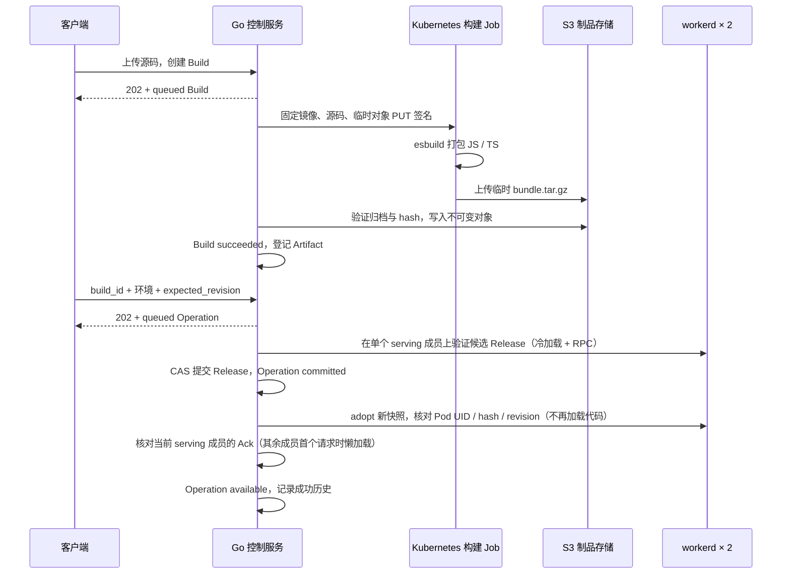

# Workers 构建与发布后端（第一版）

实现位置：`internal/control/workers_*.go`、`workers/builder`、`workers/runtime`。复用现有 Go 控制服务的登录、API Key、Cedar 权限和 PostgreSQL 状态存储。后续已接入现有 React 控制台，体验入口与验证见 [Workers 控制台](workers-console.md)。kind 部署与验收入口见 [部署说明](../deploy/workers-kind/README.md)。

## 实际流程



构建和发布都异步处理。Build、源码、Operation、Release、历史、幂等记录和执行者身份持久化在 PostgreSQL 的现有 `krun_control_state` 快照中。未完成记录就是持久化工作队列；控制服务重启后扫描恢复。多个控制服务通过 PostgreSQL session advisory lock 选出一个协调者，确定性 Job 名防止重复创建。此版没有引入 Redis 或外部消息队列。

Kubernetes、S3 和 runtime HTTP 请求均在 IAM 状态事务外进行。执行者的用户状态、AuthVersion、API Key 和当前权限会在执行及提交前重新检查。

## 构建和制品

源码请求包含相对路径文件映射及入口。固定 `esbuild 0.28.2` 将源码编译为一个 ESM 模块，支持相对 JS / TS / JSON 依赖，以及 `cloudflare:workers`、`cloudflare:sockets` 内建模块。构建容器不执行用户代码、npm 安装、生命周期脚本或自定义构建命令。裸 npm 依赖和任意文件系统导入会报错。

每次构建为独立 Kubernetes Job：非 root、无 ServiceAccount Token、只读根文件系统、独立临时目录、CPU / 内存限额、120 秒 Job deadline。Builder 只获得一个临时对象的 15 分钟 PUT 签名，不获得 S3 长期凭证。源码 ConfigMap 不注入业务凭证。

归档仅包含：

```text
bundle.tar.gz
├── manifest.json
└── modules/index.js
```

Manifest 固定为 schema 1、profile `esbuild-esm-v1`，登记模块类型、大小及 SHA-256。平台拒绝目录越界、符号链接、重复条目、非预期文件、超限大小、截断归档和 hash 不符的模块。编译器还生成 `KrunValidation` RPC，检查默认导出是否有 `fetch`，并实际触发模块初始化。

存储键：

```text
临时：uploads/{organization_id}/{build_id}/bundle.tar.gz
正式：v1/{organization_id}/sha256/{archive_sha256}/bundle.tar.gz
```

Artifact 记录包含 `storage_location_id`、`bucket`、`object_key`、归档 / manifest / 模块的 SHA-256、归档大小、组织和创建时间。第一版仅配置一个 storage location；其 ID 必须稳定指向同一个存储位置。已有 location ID 不能直接改为另一个桶或 endpoint，需要显式迁移。为兼容此次实验较早记录，缺失 location / bucket 的旧记录沿用当前存储配置。

正式对象用条件 PUT 防止覆盖，已存在对象必须与本次内容完全一致。相同组织、相同归档复用 Artifact。Job 成功并不直接代表 Build 成功：只有平台完成验证和正式对象登记才标记 `succeeded`。成功 finalize 后删除临时对象。每次冷加载再次核验完整归档及元数据。

kind 使用 MinIO 验证真实 S3 协议；尚未验证阿里云 OSS 专用 API / 签名。

## 环境、发布和回滚

每个服务默认启用 `test`、`production`，`staging` 默认关闭，可通过环境 API 开启。各自具有独立配置 revision、Release revision、Host 和历史。

Build 是编译结果，不是某个环境的活动版本。同一个成功 Build 可发布到多个环境。构建请求的 `environment` 用于权限和构建记录，不会把生产变量写进制品。

Release（曾用名 Deployment）固定引用 Artifact、目标环境、配置 revision、普通变量和 runtime pool。ID 由这些内容计算，发布之后不修改；回滚恢复历史 Release 的代码与变量。环境 API 中的 `variables` 是下一次发布使用的配置，运行中配置以生效的 Release 为准。

发布 API 提交 `expected_revision`，防止覆盖其他发布。幂等 key 相同且请求相同返回原对象；内容不同返回 409。候选验证失败不会修改 Release。验证时核对实际 Ready Pod 与 Service EndpointSlice 的交集；提交前和确认前重新检查成员集合。

| Operation 状态 | 含义 |
| --- | --- |
| `queued` | 已持久化，尚未执行 |
| `validating` | 正在检查制品和单个 serving runtime 成员上的候选（其余成员懒加载） |
| `committed` | Release 已提交，正在等待 runtime 同步 |
| `available` | 当前 serving 成员已验证、采用快照并发送新鲜 Ack |
| `failed` | 提交前失败，或候选准备超过 deadline |
| `superseded` | 后续已验证发布替换了尚未完成确认的 Release |

`committed` 之后的基础设施故障保留状态并重试，不自动撤销 Release。环境有进行中的操作时阻止普通新发布和配置修改；允许对 `committed` 操作发起历史 Release 回滚。回滚也先验证候选，只有回滚成功提交时才将仍处于 `committed` 的原操作标记 `superseded`；若管理连接恢复后原操作先完成确认，则保留它的 `available` 状态及成功历史。历史 API 记录成功生效的 Release；未成功确认的尝试通过 Operation 查询。

此版没有跨 Pod 原子流量切换或灰度权重；短暂的新旧快照并存是预期行为。`confirmed_release_id` 保留上次已确认版本供状态展示，并非自动流量回退开关。

## 路由与代码加载

```text
kgateway 私网 listener :8080
  → 服务自己的 HTTPRoute（精确 Host，最多 3 个环境）
  → runtime-default Service :8081
  → Pod 内可信入口 Worker
  → Host 查找环境 Release
  → immutable Release
  → Worker Loader 加载业务 Worker
```

Host 默认形如 `w-{组织与服务 hash 前16位}-{environment}.workers.test`。URI 路径、query、method、body 保留。网关及入口清除客户端伪造的内部 scope / release 等 header；业务代码不能指定活动版本。未知 Host 不匹配路由；未发布环境返回 503。关闭环境后 runtime 快照标记 disabled；服务还有启用环境时，网关也移除关闭环境的 Host。全部关闭时仍可能匹配原 HTTPRoute，但 runtime 拒绝执行。

每个 Pod 只有一个 workerd 进程，可动态加载多个业务 Worker。入口通过固定 `PLATFORM` service binding 请求受限内部 API；内部制品接口只签发短时预签名 GET URL，runtime 冷加载时直连对象存储下载并在本地校验归档与模块 hash（控制面不再代理制品字节，Pod 也不持有 S3 凭证）。业务 Worker 不持有数据库或对象存储凭证。入口 Worker 的出网白名单使用 workerd 的 `network=(allow=[...])`，**只接受 CIDR**（`host:port` 会在启动时报 `invalid CIDR`），需覆盖对象存储 Service 的 ClusterIP 网段；Pod 级 NetworkPolicy 仍把实际目标钉在对象存储 Pod 的 :9000。Loader key 包含组织、服务、环境、Release、runtime 版本和构建 profile，使用不可变模块及显式变量，`globalOutbound: null`。

入口快照缓存 500ms、租约 5 秒。新 runtime 在 readiness 中加载并验证所有当前活动 Release，再进入 EndpointSlice。控制服务不可用且租约耗尽后，runtime 停止继续服务；第一版没有独立持久化路由缓存，长时间控制面故障会影响业务可用性。

实验为单个 `default` pool、私网入口。公网入口、多 pool 配置、Service / DB bindings、Secrets 和动态出口策略留待后续。现有 runtime token 是 pool 内共享的受限凭证，生产应替换为可绑定 workload identity 的认证。隔离测试覆盖 HTTP、TCP 出口和凭证注入边界，没有宣称可阻止 V8 / workerd 原生漏洞逃逸。

## API

以下路径相对 `/api/v1/orgs/{org}/services/{service}/workers`。复用已有 Session / CLI Token / API Key 鉴权；Session 写操作带 Origin 和 CSRF。组织和 API Key 创建沿用已有 session-only 规则。

| 方法与路径 | 用途 |
| --- | --- |
| `POST /builds` | 提交源码与入口，返回 202 Build |
| `GET /builds` | 按可见环境过滤构建历史 |
| `GET /builds/{id}` | 构建状态和 Artifact 引用 |
| `GET /builds/{id}/logs` | 构建完成后的日志，需 `log.read` |
| `GET /builds/{id}/source` | 源码，需 `source.read` |
| `GET /artifacts/{id}` | 当前服务可见 Build 关联的制品记录 |
| `GET /environments` | 可见环境和配置 / Release revision |
| `PATCH /environments/{env}` | 开关及下一次发布变量 |
| `POST /environments/{env}/releases` | 发布成功 Build，返回 202 Operation |
| `POST /environments/{env}/rollbacks` | 发布历史 Release，返回 202 Operation |
| `GET /environments/{env}/history` | 成功生效历史 |
| `GET /operations` | 当前服务可见环境的发布操作，最多 100 条 |
| `GET /releases/{id}` | 不可变 Release 配置与制品引用 |
| `POST /environments/{env}/invoke` | 鉴权后经 Gateway 调用业务 Worker，返回文本响应封装 |
| `GET /operations/{id}` | 步骤、错误、提交与生效状态 |

构建请求：

```json
{
  "environment": "test",
  "entrypoint": "src/index.ts",
  "files": {
    "src/index.ts": "export default {fetch(req, env) {return new Response(env.GREETING || 'hello')}}"
  },
  "idempotency_key": "build-001"
}
```

环境配置和发布请求分别使用不同 revision：

```json
{"expected_revision": 1, "variables": {"GREETING": "production"}}
```

```json
{"build_id": "bld_...", "expected_revision": 0, "idempotency_key": "publish-001"}
```

回滚请求：

```json
{"release_id": "rel_...", "expected_revision": 1, "idempotency_key": "rollback-001"}
```

`build.start` 控制构建，`service.publish` / `service.rollback` 控制目标环境发布；队列提交时及执行时均检查。控制台调用需要目标环境的 `service.invoke`，内置 developer / publisher 角色具有该动作；不转发平台 Cookie 或 Authorization。集合 API 支持只拥有某个环境权限的 Key，隐藏其他环境。

## 第一版边界

源码最多 32 文件 / 合计 256 KiB，模块最多 2 MiB，归档最多 8 MiB，日志最多 32 KiB，每服务保留至多 100 个 Build。配置最多 32 个普通变量 / 合计 16 KiB，禁止使用平台预留 `KRUN_` 名称。普通变量不是 Secret。

尚无 Git 接入、npm 依赖缓存、自定义构建命令、静态资源 / Wasm 制品、构建取消、运行日志 API、独立表 / 队列、高并发优化和完整 GC。完成 Job 30 分钟后由 TTL 清理；源码 ConfigMap、失败临时对象、历史制品仍需后续 GC。实验部署采用开发登录和单节点 kind，不能直接视作生产部署模板。

仓库来源构建、服务列表与管理员来源配置见 [仓库构建说明](workers-repositories.md)。旧源码 API 保留兼容，新控制台从仓库发起构建。
