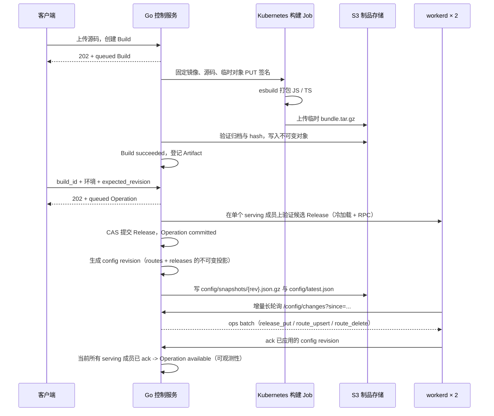

# Workers 构建与发布后端（第一版）

实现位置：`internal/control/workers_*.go`、`workers/builder`、`workers/runtime`。复用现有 Go 控制服务的登录、API Key、Cedar 权限和 PostgreSQL 状态存储。后续已接入现有 React 控制台，体验入口与验证见 [Workers 控制台](workers-console.md)。kind 部署与验收入口见 [部署说明](../deploy/workers-kind/README.md)。

Workers 与认证配置在同一个 YAML 文件，完整示例见 [config/example.yaml](../config/example.yaml) 的 `workers:` 段。配置该段即启用 Workers；省略时控制面仍正常启动，所有 Workers 接口返回 `503 WORKERS_NOT_CONFIGURED`，`/api/auth/me` 的 `workers_configured` 为 `false`，控制台显示“Workers 未配置”。

对象存储可按网络视角配置三个地址：`s3_endpoint` 供控制面读写，
`s3_builder_endpoint` 供构建器上传，`s3_runtime_endpoint` 供 runtime 冷加载制品和资产。
三者必须指向同一个桶；完整集群部署通常相同，local-first 的 runtime 地址则应使用集群
可达的 `static-assets` Service。后两项省略时会逐级回退，兼容原有配置。

## 实际流程



构建和发布都异步处理。Build、源码、Operation、Release、历史、幂等记录和执行者身份都按实体持久化在 PostgreSQL 的 `krun_worker_*` 表中；`krun_control_state` 只作为迁移期遗留数据源。边缘配置的当前发布头按 route / release 分行保存在 `worker_config_routes` 与 `worker_config_releases`，`worker_config_revisions` 只保存 revision 元数据，增量则是一条 op 一行的 `worker_config_ops`。runtime ack 存在独立的 `worker_runtime_acks`（每个 Pod 一行）。未完成的 Build / Operation 行就是持久化工作队列；控制服务重启后扫描恢复。多个控制服务通过行级 CAS 与超时租约竞争不同工作，配置发布通过 `worker_config_head` CAS 线性推进，不做 advisory-lock 选主。此版没有引入 Redis 或外部消息队列。

Kubernetes、S3 和 runtime HTTP 请求均在 IAM 状态事务外进行。执行者的用户状态、AuthVersion、API Key 和当前权限会在执行及提交前重新检查。

## 构建和制品

源码请求包含相对路径文件映射及入口。固定 `esbuild 0.28.2` 将源码编译为一个 ESM 模块，支持相对 JS / TS / JSON 依赖，以及 `cloudflare:workers`、`cloudflare:sockets` 内建模块。构建容器不执行用户代码、npm 安装、生命周期脚本或自定义构建命令。裸 npm 依赖和任意文件系统导入会报错。

每次构建为独立 Kubernetes Job：非 root、无 ServiceAccount Token、只读根文件系统、独立临时目录、CPU / 内存限额、120 秒 Job deadline。Builder 只获得一个临时对象的 15 分钟 PUT 签名，不获得 S3 长期凭证。源码 ConfigMap 不注入业务凭证。

归档仅包含：

```text
bundle.tar.gz
├── manifest.json
└── modules/index.js
```

Manifest 固定为 schema 1、profile `esbuild-esm-v1`，登记模块类型、大小及 SHA-256。平台拒绝目录越界、符号链接、重复条目、非预期文件、超限大小、截断归档和 hash 不符的模块。编译器还生成 `KrunValidation` RPC，检查默认导出是否有 `fetch`，并实际触发模块初始化。

存储键：

```text
临时：uploads/{organization_id}/{build_id}/bundle.tar.gz
正式：v1/{organization_id}/sha256/{archive_sha256}/bundle.tar.gz
```

Artifact 记录包含 `storage_location_id`、`bucket`、`object_key`、归档 / manifest / 模块的 SHA-256、归档大小、组织和创建时间。第一版仅配置一个 storage location；其 ID 必须稳定指向同一个存储位置。已有 location ID 不能直接改为另一个桶或 endpoint，需要显式迁移。

正式对象用条件 PUT 防止覆盖，已存在对象必须与本次内容完全一致。相同组织、相同归档复用 Artifact。Job 成功并不直接代表 Build 成功：只有平台完成验证和正式对象登记才标记 `succeeded`。成功 finalize 后删除临时对象。每次冷加载再次核验完整归档及元数据。

kind 使用 MinIO 验证真实 S3 协议；尚未验证阿里云 OSS 专用 API / 签名。

## 环境、发布和回滚

每个服务默认启用 `test`、`production`，`staging` 默认关闭，可通过环境 API 开启。各自具有独立配置 revision、Release revision、Host 和历史。

Build 是编译结果，不是某个环境的活动版本。同一个成功 Build 可发布到多个环境。构建请求的 `environment` 用于权限和构建记录，不会把生产变量写进制品。

Release（曾用名 Deployment）固定引用 Artifact、目标环境、配置 revision、普通变量、Secret version 集合和 runtime pool。ID 由这些内容计算，发布之后不修改；回滚恢复历史 Release 的代码、变量和 Secret。环境 API 中的 `variables` 是下一次发布使用的配置，运行中配置以生效的 Release 为准。

Secret 的行为与 Cloudflare Worker 默认命令一致：`PUT`（新增或轮换）和 `DELETE` 都创建不可变 Release 并立即进入发布流程，但复用当前 Artifact，不重新构建代码。每个环境保存 name → secret version 的期望映射，每个 Release 再固定一份映射，因此轮换后仍能准确回滚。值以 AES-256-GCM 加密后入库，AAD 绑定组织、服务、环境、名称和版本；公开 API 只返回名称与创建时间。`workers.secrets_keys` 是带版本的 key ring，`secrets_active_key` 只用于新写入，仍被保留 Release 引用的旧 key 不得删除。生产 key 应由 KMS/Secret Manager 注入配置，而不是提交到仓库。

发布 API 提交 `expected_revision`，防止覆盖其他发布。幂等 key 相同且请求相同返回原对象；内容不同返回 409。候选验证失败不会修改 Release。验证时核对实际 Ready Pod 与 Service EndpointSlice 的交集；提交前和确认前重新检查成员集合。

| Operation 状态 | 含义 |
| --- | --- |
| `queued` | 已持久化，尚未执行 |
| `validating` | 正在检查制品和单个 serving runtime 成员上的候选（其余成员懒加载） |
| `committed` | Release 已提交，正在等待 runtime 同步 |
| `available` | 当前 serving 成员已验证、采用快照并发送新鲜 Ack |
| `failed` | 提交前失败，或候选准备超过 deadline |
| `superseded` | 后续已验证发布替换了尚未完成确认的 Release |

`committed` 之后的基础设施故障保留状态并重试，不自动撤销 Release。只有 `queued` / `validating` 的操作会阻止新的发布和配置修改；`committed` 表示已提交、正在收敛，新发布可以入队并在提交时 supersede 尚未确认的旧操作。回滚也先验证候选，只有回滚成功提交时才将仍处于 `committed` 的原操作标记 `superseded`；若管理连接恢复后原操作先完成确认，则保留它的 `available` 状态及成功历史。历史 API 记录成功生效的 Release；未成功确认的尝试通过 Operation 查询。

此版没有跨 Pod 原子流量切换或灰度权重；短暂的新旧快照并存是预期行为。`confirmed_release_id` 保留上次已确认版本供状态展示，并非自动流量回退开关。

## 路由与代码加载

```text
kgateway 私网 listener :8080
  → 服务自己的 HTTPRoute（精确 Host，最多 3 个环境）
  → runtime-default Service :8081
  → Pod 内可信入口 Worker
  → Host 查找环境 Release
  → immutable Release
  → Worker Loader 加载业务 Worker
```

Host 默认形如 `w-{组织与服务 hash 前16位}-{environment}.workers.test`。URI 路径、query、method、body 保留。网关及入口清除客户端伪造的内部 scope / release 等 header；业务代码不能指定活动版本。未知 Host 不匹配路由；未发布环境返回 503。关闭环境后 runtime 配置投影标记 disabled；服务还有启用环境时，网关也移除关闭环境的 Host。全部关闭时仍可能匹配原 HTTPRoute，但 runtime 拒绝执行。

配置了资产的版本在入口 Worker 内多一层路径决策：`run_worker_first` 命中 → 业务 Worker；否则查资产表（含 `html_handling` 规范化）→ 命中直接返回（ETag/304）；未命中且是导航请求 → 按 `not_found_handling` 返回 `index.html`；其余交给业务 Worker。资产按文件从桶的 `pub/` 前缀懒加载并做进程内 LRU，归档（`v1/` 前缀）始终需要凭证。两个静态域（`static.{domain}` / `static.{internal_domain}`）各有一条共享 HTTPRoute，路径改写为桶对象 key 后直接反代对象存储。

每个 Pod 只有一个 workerd 进程，可动态加载多个业务 Worker。入口通过固定 `PLATFORM` service binding 请求受限内部 API；内部制品接口只签发短时预签名 GET URL，runtime 冷加载时直连对象存储下载并在本地校验归档与模块 hash（控制面不再代理制品字节，Pod 也不持有 S3 凭证）。当 Release 含 Secret 时，入口再按精确 Release ID 从内部接口取值，核对绑定摘要后仅在 Loader 创建业务 isolate 时注入内存；Secret 不进入对象存储快照、公开 Release JSON 或业务日志。业务 Worker 不持有数据库或对象存储凭证。入口 Worker 的出网白名单使用 workerd 的 `network=(allow=[...])`，**只接受 CIDR**（`host:port` 会在启动时报 `invalid CIDR`），需覆盖对象存储 Service 的 ClusterIP 网段；Pod 级 NetworkPolicy 仍把实际目标钉在对象存储 Pod 的 :9000。Loader key 包含组织、服务、环境、Release、runtime 版本和构建 profile，使用不可变模块及显式变量，`globalOutbound: null`。

### 边缘配置分发

入口 Worker 不再每 500ms 轮询完整快照，而是“不可变快照 + 增量 ops + 内存视图”：

1. **bootstrap**：启动时读取 `{config_base_url}/latest.json` → `{config_base_url}/{latest.snapshot}`（对象键是 `config/snapshots/{rev}.json.gz`），校验 SHA-256 与 revision；对象存储不可达时回退到控制面 `GET /api/internal/workers/config/snapshot`。
2. **增量**：`GET /api/internal/workers/config/changes?since={rev}&wait=5s`，返回 `{from,to,ops}`；无变化返回 204；落后超过保留窗口返回 409，重新 bootstrap。
3. **应用**：ops 只有 `release_put` / `route_upsert` / `route_delete`，在内存 Map 副本上应用后原子替换视图；不落盘、不落本地 DB。
4. **ack**：每个 Pod 应用新 revision 后上报 `{pod_uid, pool, revision}`，并每 5 秒心跳；ack 写入独立的 `worker_runtime_acks`，不参与 IAM 快照。

`config/` 前缀与 `pub/`、`int/` 一样匿名可读，但只能通过集群内 endpoint 访问（`config_base_url` 必须指向私有地址）；生产应使用独立桶或带 VPC 条件的桶策略。对象存储快照只含 host → release 指针和不可变 Release 描述符，不含 Build、Operation、日志或 IAM 数据。PostgreSQL 不保存每个 revision 的全量投影，只保存一份归一化当前头和最近 512 个 revision 的逐实体 ops；超窗的 Pod 通过 409 回全量。

控制面不可用时，已运行的 Pod 继续用最后一份内存视图服务；新 Pod 仍可从对象存储 bootstrap。尚未缓存的 Release 冷加载仍需控制面签发短时 presigned URL，因此“新版本冷启动”依赖控制面，“已加载版本继续服务”不依赖。

controller 不对每个 Pod 做管理 RPC。`/validate` 仍只在单个候选成员上冷加载并运行 `KrunValidation`；commit 后由配置流传播，controller 通过 `worker_runtime_acks` 观察收敛，`available` 表示当前 serving 成员都已上报该 revision。readiness 只要求配置视图已加载；Release 在首次请求时懒加载，避免 Pod 启动成本随服务数量线性增长。

实验仍只有单个 `default` pool；公网域名目录与 Gateway 路由已实现，多 pool、Service / DB bindings 和按 pool 的出口策略留待后续，详细方案见 [Workers 资源池与网络策略设计](workers-pools.md)。Secret binding 已支持；现有 runtime token 仍是 pool 内共享的受限凭证，生产应替换为可绑定 workload identity 的认证。隔离测试覆盖 HTTP、TCP 出口和凭证注入边界，没有宣称可阻止 V8 / workerd 原生漏洞逃逸。

## API

以下路径相对 `/api/v1/orgs/{org}/services/{service}/workers`。复用已有 Session / CLI Token / API Key 鉴权；Session 写操作带 Origin 和 CSRF。组织和 API Key 创建沿用已有 session-only 规则。

| 方法与路径 | 用途 |
| --- | --- |
| `POST /source-uploads` | 领取源码包 presigned PUT（`src/` + `assets/`），返回 `source_upload` |
| `POST /builds` | 提交源码包（或内联 `files`）与入口，返回 202 Build |
| `GET /builds` | 按可见环境过滤构建历史 |
| `GET /builds/{id}` | 构建状态和 Artifact 引用 |
| `GET /builds/{id}/logs` | 构建完成后的日志，需 `log.read` |
| `GET /builds/{id}/source` | 源码包下载 URL（或内联文件表），需 `source.read` |
| `GET /artifacts/{id}` | 当前服务可见 Build 关联的制品记录 |
| `GET /environments` | 可见环境和配置 / Release revision |
| `PATCH /environments/{env}` | 开关及下一次发布变量 |
| `GET /environments/{env}/secrets` | Secret 元数据（仅名称与创建时间） |
| `PUT /environments/{env}/secrets/{name}` | 新增或轮换 Secret，自动创建并发布 Release |
| `DELETE /environments/{env}/secrets/{name}` | 删除 Secret，自动创建并发布 Release |
| `POST /environments/{env}/releases` | 发布成功 Build，返回 202 Operation |
| `POST /environments/{env}/rollbacks` | 发布历史 Release，返回 202 Operation |
| `GET /environments/{env}/history` | 成功生效历史 |
| `GET /operations` | 当前服务可见环境的发布操作，最多 100 条 |
| `GET /releases/{id}` | 不可变 Release 配置与制品引用 |
| `POST /environments/{env}/invoke` | 鉴权后经 Gateway 调用业务 Worker，返回文本响应封装 |
| `GET /operations/{id}` | 步骤、错误、提交与生效状态 |

内部 runtime 接口只监听 `internal_listen`，不进公开 mux，使用池级身份
`Authorization: Bearer <pool.runtime_token>` + `X-Runtime-Pool: <pool-id>`。控制面同时校验
header 与该 pool 独立 token，不能只信任 header：

| 方法与路径 | 用途 |
| --- | --- |
| `GET /api/internal/workers/config/snapshot` | 最新全量配置投影（bootstrap 回退） |
| `GET /api/internal/workers/config/changes?since=&wait=5s` | 增量 ops：200 批次、204 超时、409 重新 bootstrap |
| `GET /api/internal/workers/releases/{id}/assets` | 资产 manifest |
| `GET /api/internal/workers/releases/{id}/assets/{path...}` | 单文件短时 presigned GET |
| `GET /api/internal/workers/releases/{id}/secrets` | 精确 Release 的 Secret 值，仅供 runtime Loader |
| `GET /api/internal/workers/artifacts/{id}` | 制品短时 presigned GET |
| `POST /api/internal/workers/ack` | 上报已应用的 config revision（每 Pod 一行） |

构建请求（静态资产随源码包进入，见 [静态资产设计](workers-assets.md)）：

```json
{
  "environment": "test",
  "entrypoint": "src/index.ts",
  "source_upload": "uploads/{org}/src/src_xxx/source.tar.gz",
  "assets": {
    "directory": "public",
    "run_worker_first": ["/api/*"],
    "not_found_handling": "single-page-application",
    "html_handling": "auto-trailing-slash"
  },
  "idempotency_key": "build-001"
}
```

旧的内联 `files` 仍可用（仅代码，≤32 文件 / 256 KiB）；带 `assets` 时必须先 `POST /source-uploads` 并上传 `source.tar.gz`。源码包顶层固定为 `src/`（Worker 代码）与 `assets/`（相对 `assets.directory` 的文件）。

环境配置和发布请求分别使用不同 revision：

```json
{"expected_revision": 1, "variables": {"GREETING": "production"}}
```

```json
{"build_id": "bld_...", "expected_revision": 0, "idempotency_key": "publish-001"}
```

回滚请求：

```json
{"release_id": "rel_...", "expected_revision": 1, "idempotency_key": "rollback-001"}
```

`build.start` 控制构建，`service.publish` / `service.rollback` 控制目标环境发布；队列提交时及执行时均检查。控制台调用需要目标环境的 `service.invoke`，内置 developer / publisher 角色具有该动作；不转发平台 Cookie 或 Authorization。集合 API 支持只拥有某个环境权限的 Key，隐藏其他环境。

## 第一版边界

源码最多 32 文件 / 合计 256 KiB；静态资产最多 500 文件 / 合计 20 MiB / 单文件 5 MiB，含资产时归档上限 32 MiB；模块最多 2 MiB；日志最多 32 KiB；每服务保留至多 100 个 Build。配置最多 32 个普通变量 / 合计 16 KiB；Secret 最多 32 个、单值最多 16 KiB。两者都使用大写 binding 名并禁止平台预留 `KRUN_` 前缀，且不得重名。

尚无 npm 依赖缓存、自定义构建命令、Wasm 制品、构建取消、运行日志 API、独立构建队列、高并发优化和完整 GC。完成 Job 30 分钟后由 TTL 清理；源码 ConfigMap、失败临时对象、历史制品仍需后续 GC。实验部署采用开发登录和单节点 kind，不能直接视作生产部署模板。

仓库来源构建、服务列表与管理员来源配置见 [仓库构建说明](workers-repositories.md)。内联源码 API 仍可用于小 Worker；新控制台从仓库发起构建。
