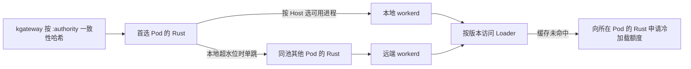

# Workers 资源池与网络配置

资源池、Network Profile、Gateway 和域名统一由主 YAML 的 `workers:` 段配置，字段以
[配置示例](../config/example.yaml) 和 `WorkersConfig` 为准。系统管理员可在
「平台管理 → 系统配置」只读查看当前控制面加载的资源池、默认池、入口与出口策略、
候选校验方式及匹配的 Network Profile。页面显示配置声明，实际副本数和健康状态由集群提供。
凭据、内部地址、服务名及标签和选择器原文仅保留在部署侧。

## 资源池与服务分配

`runtime_pools` 定义池 ID、public/private 入口能力、标签、出口能力、serving Service
及认证凭据。每个池对应部署侧维护的 workerd 运行环境。

候选校验有两种模式，在同一主配置的 `workers:` 段二选一：

- `validator_pool: ""`（默认）：从业务当前 placement 的 Ready serving Pod 中选一个。
  不额外创建 validator；候选使用独立 WorkerLoader 实例和 Cache API 命名空间，禁用
  对象存储签名和传输。候选与业务共享进程 CPU、内存，失败或资源耗尽仍可能影响业务。
- `validator_pool: <pool-id>`：所有业务 pool 共用所选池的独立 validator。所选池必须
  配置 `validator_service`，且与 serving Service 不同；部署方需要为该池维护独立 validator
  Deployment、管理 Service、配置及 NetworkPolicy，且不能允许 Gateway 入站。

控制面使用目标池的 management token，并仅发送本次候选的不可变描述符、短时制品 URL
及绑定的 Secret 值。不会把业务池 runtime token 交给共享 validator；内部数据接口的
placement 权限保持不变。校验后再次检查 Ready EndpointSlice 成员，变化时重试。
无可用成员时等待，不跨模式回退。

升级期间暂停发布，先升级 runtime 镜像，再升级控制面后恢复发布。控制面通过 `/ready` 的 `validation_protocol: 1`、
role、pool 和 Pod UID 确认能力，旧镜像不会执行候选。已有独立 validator 不会被控制面自动删除，切换模式并确认发布成功后，由运维显式清理未再使用的资源。

校验检查制品、模块初始化及 `KrunValidation`，不遍历业务 `fetch()` 分支，也不执行真实
对象存储读写。通过校验不代表目标业务 pool 的网络、存储权限、配置分发或资源容量已通过
验证；这些能力需要在目标 serving pool 上用真实请求检查。

组织用户选择 `network_profiles` 中公开且获准使用的产品配置。Profile 通过
`pool_selector`、`domain_selector` 与入口/出口 requirements 筛选基础设施；名称和 ID
不代表网络能力。每个 domain 经 Profile 必须只匹配一个运行池，否则配置加载失败。
服务 placement 仍持久化；扩容通过增加同一池的副本实现。

一个服务的 production 与所有 preview 环境共用一个 active primary placement。
Version 固定代码和配置，不携带 pool；路由和内部制品访问根据有效 placement 限定池。
首次发布后不能由组织侧切换 Network Profile。

## 入口与域名

生产业务 host 为 `<worker-name>.<domain>`，Preview 为 `<preview-name>-<worker-name>.<domain>`。
控制面按 `(pool, domain)` 协调共享通配 HTTPRoute，后端是该池 serving Service，
因此网关资源数量由基础设施目录决定。静态资产按 domain 单独协调。

每个 domain 显式绑定 Gateway。不同入口的隔离来自独立 Gateway 实例及其路由集合；
在一个 Gateway 上伪造另一个 domain 的 Host 不会匹配路由。DNS、TLS 和部署侧代理
必须覆盖 `*.<domain>`。细节见 [域名与路由](workers-domains.md)。

## 承流与容量

正式 serving Pod 使用单个 4 核、8 GiB 容器。Rust supervisor 管理两个普通 workerd 和
两个默认常驻的计算 workerd。业务版本继续按需加载，独立 validator 直接运行 workerd。
`workers.runtime_pools[].execution` 的参数及默认值见 [生产配置示例](../config/production.example.yaml)。
在 `compute_hosts` 里填写完整业务域名即可分配到计算组，其余域名进入普通组。
`compute_processes: 0` 时该池所有请求进入普通组。

kgateway 对每个 serving Service 应用 `BackendConfigPolicy`，使用同一域名选择入口 Pod。
Rust 从同池 headless Service 发现候选，记录近期拒绝和剩余额度。执行端口 8082 仅向同池
Pod 开放，需要池认证和单跳标记；收到转发的 Pod 只在本地选 workerd。入口 Pod 消失后，
网关根据 Ready endpoints 选择新的入口。进程退出由所在 Pod 的 Rust 重启。超时后可能已
执行的请求不重放，明确容量拒绝且没有请求体的 GET/HEAD 在短预算内最多补选一次。
### SSE 与 WebSocket

在池的 `execution.streams` 配置启用后，WebSocket Upgrade、接受
`text/event-stream` 的请求，以及 `sse_paths` 中的精确路径走同池的长流 Service。
对于用普通 Accept 头的模型客户端，配置专用的 SSE 路径。
kgateway 按活跃请求量选择长流入口，普通流量继续按域名亲和。部署清单会为关联的
Gateway 生成 WebSocket Upgrade 策略。长流规则的
`request` 和 `backendRequest` 超时设为 `0s`，让流的生命周期由服务和空闲超时管理。

SSE 与 WebSocket 共享长流额度，短请求保有原来的独立额度。默认每 workerd
可接 300 条流，每 Pod 分别限制 600 条承流和 600 条执行。每个入口到一个远端 Pod，也按执行组设独立的长流额度。
Rust 在转发前为新流占用额度，结束或断开时释放。进程 CPU 与 Pod CPU 水位仍然生效。
长流连接固定在选中的 workerd，故障后的重连走新的入口和选点。

每次准入使用采样中的 Pod CPU、主线程 CPU 和 workerd 在途数。单进程默认 0.75 核暂停准入，
降到 0.525 核后恢复，Pod 预留 1 核。Loader 回调只在需要新加载时检查 Pod 内存和版本条目，
默认预留约 20% 内存并限制四个并行冷加载。已有热 Worker、静态资源和响应缓存继续沿用
现有逻辑。上限 650 是单进程的 Loader 跟踪条目数，配置仍需根据实际制品大小、RSS 和
延迟调整。

每个 workerd 仍使用现有 JS 入口选择版本并执行灰度、静态资源和 bindings 逻辑，各自读配置。
Rust 依据所有子进程的配置游标放行 Pod ACK。热请求的承流选择只依赖本地状态。
配置同步、冷路由、制品及绑定缺失时继续访问控制面或对象存储。容量指标按
`workerd_slot` 和 `execution_group` 区分，可在 [Runtime 大盘](../deploy/observability/README.md) 查看。
合成负载复现命令和历史基线见 [执行池压测](../tests/runtime-load/README.md)。

## 配置分发与权限

每站点 dirty 队列驱动增量发布，Runtime 只跟随本池 ops，冷 host 定向读取。
对象存储为每个池保存紧凑 head 和 256 个 host-hash shard checkpoint。Runtime 内存
缓存有界，不在启动时加载全池站点。详见 [规模与验证](performance-scaling.md)。

内部 listener 要求 `X-Runtime-Pool` 和对应 Runtime token；路由、Version、Artifact、
Secret 与资产读取继续校验该池有效 placement。Version Secret 接口仅接受对应池的
serving runtime token。候选验证通过 management token 认证，所需的 Secret 随验证请求传递。
业务 Worker 无平台 token、对象存储密钥或控制面 binding。

各池使用独立的 Runtime 凭据、配置流和路由范围；某池明确的配置认证拒绝不会清空其他池的视图。
独立 serving Deployment、Service、Gateway 和存储权限可以限定资源或入口故障的范围。
共享控制面、PostgreSQL 或对象存储仍是共同依赖，分池本身不消除这些故障；断连时依靠各池最后确认的本地状态继续承流。
需要不同故障范围的业务应使用独立池及部署资源，控制面断连策略见[边缘配置分发](workers-backend.md#边缘配置分发)。

## 公网出网

池显式配置 `public_egress: direct` 后，serving workerd 给业务 Worker 提供独立公网出口。
Worker 可通过 `fetch()` 访问公网 HTTP 和 HTTPS，通过 `cloudflare:sockets` 的 `connect()`
访问公网 TCP。workerd 按实际解析地址过滤，拒绝私有地址和
`workers.protected_egress_cidrs` 中的部署侧保护地址。部署方应在该列表加入公网可路由的
控制面和管理地址。候选校验保持关闭全局出网。

省略池的出口字段时默认使用 `deny`。配置改变后重新渲染并重启 serving workerd。
实际连通性还受宿主机网络和部署环境出口规则约束。
PostgreSQL 托管接入的池级出网限制见 [Workers 出网](workers-egress.md)。

## 运维

基础设施目录变更通过重新加载主配置生效；影响路由的配置 hash 变化会将服务加入有界
重建队列。不能把已有池 ID 或存储位置 ID 静默指向不同的安全边界或数据位置。
开发使用 [local-first](local-dev.md)，完整验收使用独立 [kind 栈](../deploy/workers-kind/README.md)。

## Runtime API 地址

部署方在主配置设置 `workers.runtime_api_url`，例如 `https://console.example.com`。
留空时 workerd 使用控制面内部 Service；配置后 serving 和 validator 均通过该 HTTPS
origin 调用 `/api/internal/workers/*`。该设置会接收 pool 认证 token，不向组织/Worker
用户开放，也不进入业务 binding。只接受无凭据、路径、query、fragment 的 HTTPS origin。

workerd 验证服务器证书与 SNI，并发送配置域名的 Host。部署方负责配置 Runtime API
路由及所需的网络访问，并提供 DNS、证书和 TLS 终止。前置代理须保留 `Authorization`、
`X-Runtime-Pool` 及请求路径；未知凭据继续返回 403。

地址修改后需更新 Runtime 配置并重启对应工作负载；不需要重新构建 Worker 制品。该配置
不修改对象存储地址或控制面调用 runtime 管理端口的 Pod 选址。
