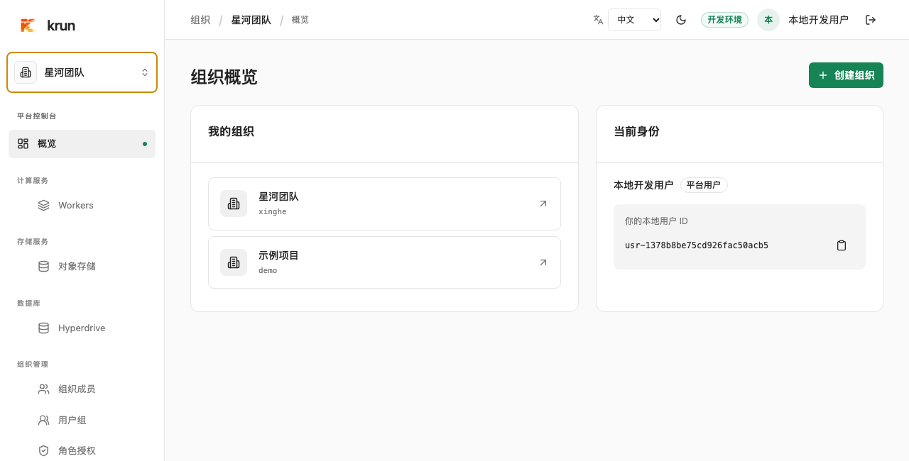
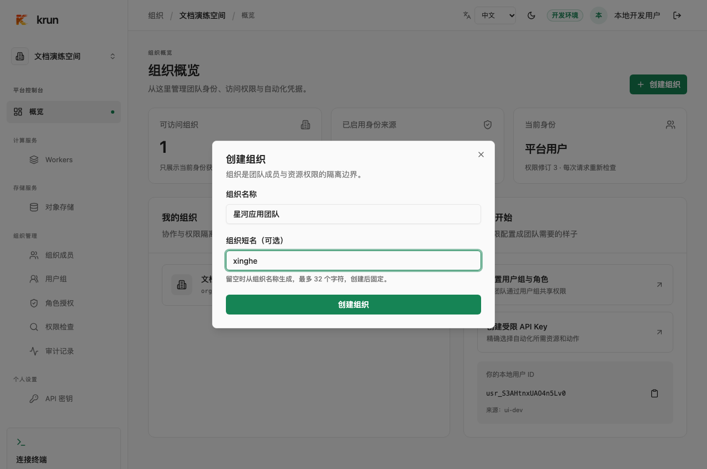
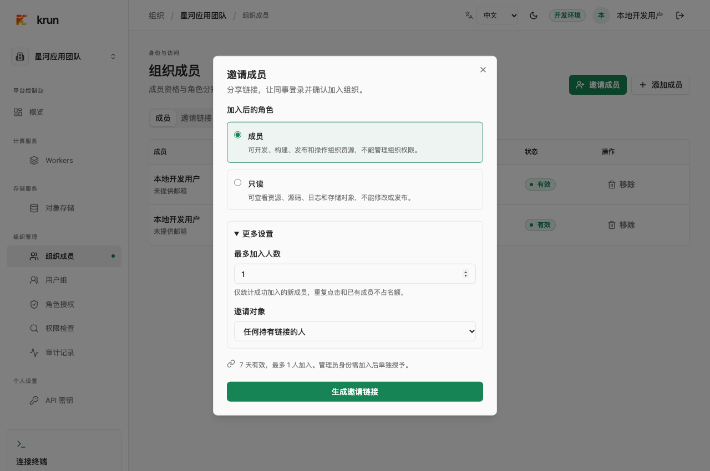
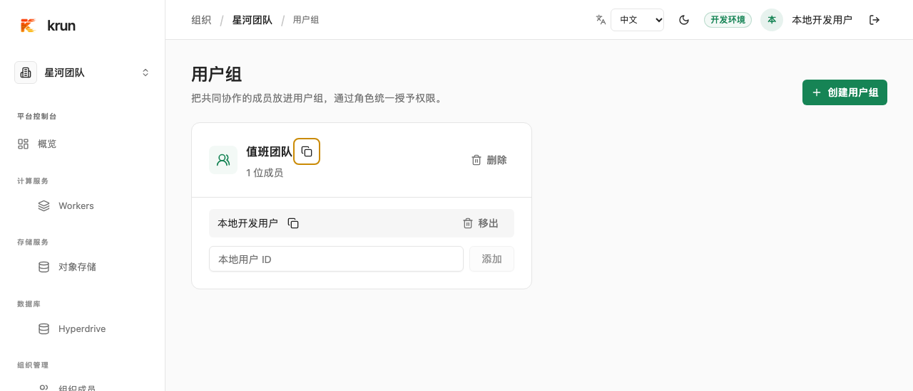
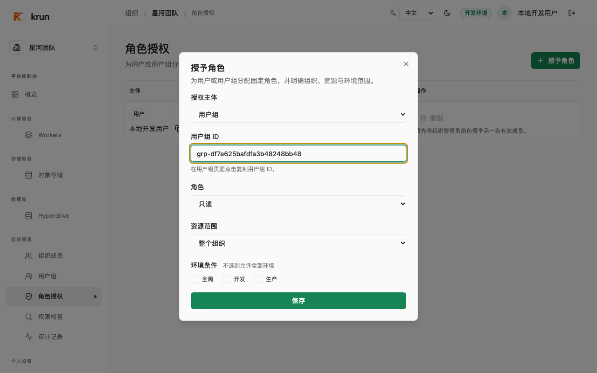

在 krun 里，**组织就是团队使用 Workers 和对象存储的工作空间**。同一个账号可以加入多个组织，在不同组织里承担不同角色。进入控制台后，先看左上角的组织名称，确认你正在操作哪个团队的资源。

## 加入团队的组织

1. 在浏览器打开同事发给你的邀请链接。
2. 在同一个标签页登录。已登录时，先核对页面显示的账号。
3. 点击**加入组织**，再点击**进入组织**。之后可以从左上角的组织菜单切换回来。

管理员也可以手动添加你。在控制台概览的**当前身份**卡片复制本地用户 ID 发给管理员，请对方添加成员并分配角色。团队要求用指定登录方式时，请用该方式登录。通过不同方式登录，即使邮箱相同，也可能是两个独立的账号。

## 为什么同事能操作，我只能看？

**加入组织**让你成为团队成员。**角色**决定你在组织里能做什么。通过邀请加入时会一并获得邀请指定的角色。管理员手动添加成员时，需要再分配角色，或把成员加入已获授权的用户组。

| 角色 | 通常可以做什么 |
| --- | --- |
| **只读** | 查看 Worker、版本和日志，浏览或下载存储对象。 |
| **成员** | 拥有只读权限，还可以开发、构建、发布和回滚 Worker，以及上传和删除存储对象。 |
| **组织管理员** | 拥有成员权限，还可以邀请成员、管理用户组和角色、查看本组织的审计记录。 |

表中列的是授予整个组织时的常用权限。管理员也可以只给你某个 Worker 或某个环境的权限。比如，你能查看团队所有 Worker，但只有 `edge-api` 的生产发布权限。角色可以直接授给你，也可以由你加入的用户组提供。

## 创建自己的组织

在**组织概览**点击**创建组织**，填写组织名称。可以选填一个短名，例如 `xinghe`，方便在 CLI 和资源路径里引用。短名留空时会根据名称生成，创建后固定。

创建成功后，你会自动成为这个组织的管理员。若没有看到**创建组织**按钮，请联系平台管理员确认是否开放自助创建。

## 邀请同事

1. 切换到目标组织，打开**组织成员 → 邀请成员**。
2. 选择**成员**或**只读**。两种邀请角色都覆盖整个组织和全部环境。
3. 点**生成邀请链接**，复制并发给同事。链接有效期为 7 天，默认允许 1 位新成员加入。需要指定账号、已验证邮箱或调整人数时，展开**更多设置**。

在**组织成员 → 邀请链接**中可以查看使用情况或撤销链接。完整链接只在生成时显示。撤销后，已经加入的同事保留原有权限。

## 给团队分配角色

如果几位同事需要相同的权限，可以把他们放进同一个用户组。

1. 在**用户组 → 创建用户组**创建「值班团队」。在组卡片底部输入已有成员的本地用户 ID，点**添加**。
2. 点击组卡片上的**复制用户组 ID**按钮。CLI 的 `krun groups add-member --org xinghe --group GROUP_ID --user USER_ID` 和 `krun roles grant --org xinghe --subject-kind group --subject GROUP_ID --role viewer` 也使用这个 ID。

   

3. 打开**角色授权 → 授予角色**。把**授权主体**选为**用户组**，填入组 ID。比如，给值班团队选**只读**和**整个组织**，环境条件都不勾选，即可让组内成员查看团队资源。
4. 点击**保存**。如果只给一位同事授权，把**授权主体**选为**用户**，填写对方的本地用户 ID。

   

要收回权限，在**角色授权**中撤销对应授权，或在**用户组**中移出成员。成员通过其他组或直接授权获得的权限仍然有效。交接管理员时，先给接任者授予**组织管理员**，再收回原管理员的权限。

## 找不到组织、资源或操作按钮

- **看不到组织**。核对登录方式和账号，再请管理员检查你是否已加入并获得角色。
- **看得到组织，但找不到 Worker 或发布按钮**。确认左上角选的是目标组织，再核对角色是否覆盖该 Worker 和目标环境。可以在**权限检查**中检查当前账号，例如选择 Worker、填入资源 ID、动作填 `worker.publish`，再选择要发布的环境。
- **邀请链接用不了**。核对是否登录了受邀账号。链接已过期、名额已用完或已被撤销时，请管理员重新发一个。
